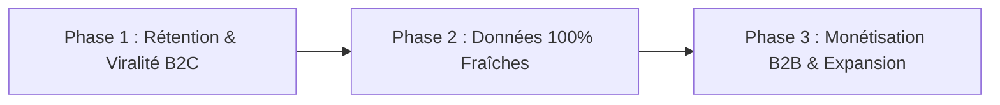

# Tfarhida (تفرهيدة) — Récapitulatif des Fonctionnalités & Feuille de Route Stratégique

Ce document détaille l'état complet du projet **Tfarhida / ActivityTN** : l'inventaire exhaustif des fonctionnalités déjà développées et validées, ainsi que la feuille de route des fonctionnalités recommandées pour garantir la rétention des utilisateurs, la fraîcheur des données et la monétisation en Tunisie.

---

## 1. Fonctionnalités Complétées & Opérationnelles (Production Ready)

### A. Plateforme Web (`landing`)

* **Identité Visuelle & Logotype Officiel (Brand Book)** :
  * Intégration du logotype officiel avec le monogramme 3D en ruban « T » et typographie *farhida*.
  * Double déclinaison dynamique :
    * **Mode Clair** : typographie Bleu Nuit signature (`#051227`) sur fond blanc satiné.
    * **Mode Sombre** : typographie Blanc Pur (`#FFFFFF`) pour un contraste optimal sur fond sombre.
  * Déclinaison arabe dédiée avec monogramme [T] et calligraphie *تفرهيدة*.
  * Favicon haute résolution synchronisé.

* **Hero Section Cinématographique** :
  * Vidéo aérienne HD de Sfax (`1030.mp4`) avec barque tunisienne et vue sur la mairie.
  * Image poster instantanée (`hero-video-poster.jpg`) évitant tout écran noir au chargement.
  * Voile dégradé supérieur protecteur pour les textes.
  * Fondu inférieur progressif (`.hero-bottom-fade`) actif uniquement sur les derniers 28% de la section (0% d'effet brouillard sur la barque et l'eau turquoise).
  * Barre de recherche intelligente avec debounce, suggestions backend en direct, défilement fluide vers l'explorateur et micro-célébration (confetti).

* **Système de Navigation Adaptatif (Navbar)** :
  * Mode Clair : bandeau blanc satiné dépoli (`rgba(255, 255, 255, 0.94)` + blur 16px) style Apple/Airbnb.
  * Mode Sombre au sommet : transparence cinématographique (`.on-hero`) avec textes blanc pur, ombres portées et boutons en verre fumé dépoli.
  * Au défilement : transition fluide vers le fond cosmic navy (`rgba(6, 11, 36, 0.94)`).
  * Menu tiroir mobile réactif avec support tactile.

* **Internationalisation Complète (i18n & RTL)** :
  * Support trilingue fluide : Français (FR), Arabe (AR) et Anglais (EN).
  * Inversion bidirectionnelle complète (`dir="rtl"`) avec adaptation des flèches, des espacements et de la typographie arabe (*Noto Kufi Arabic*).

* **Section Mobile App Showcase (Apple-Inspired)** :
  * Carte en dégradé signature Bleu Royal & Cyan avec liseré satiné.
  * Mockup smartphone haute fidélité montrant l'application réelle.
  * QR Code interactif pour scan immédiat et bouton Google Play officiel.
  * Badge « Ambiance & Musique Live » et arguments clés.

* **Explorateur d'Activités & Piliers Bento** :
  * Cartes d'activités avec prix indicatif en DT, ville, ambiance, tags et badge de vérification.
  * Bento grid mettant en valeur les 3 piliers Tfarhida (Clarté des prix, WhatsApp direct, Garantie courant/générateur).
  * Modal d'onboarding partenaire B2B en 3 étapes avec simulation d'OTP SMS et contact direct.

* **Thème Sombre / Clair Persistant** :
  * Système complet de design tokens CSS (`variables.css`) synchronisé avec l'application mobile.

---

### B. Application Mobile (`activitytn`)

* **Architecture Mobile & Navigation** :
  * Stack Expo / React Native avec navigation par onglets (Explorer, Carte, Favoris, Profil, Partenaire).
  * Brand Book Tfarhida officiel (`WIN_COLORS`, `WIN_GRADIENTS`, typographie système et zéro emoji).

* **Composant Modal Unifié (`ScrollableModal`)** :
  * Modal d'édition et filtres avec défilement fluide, geste de fermeture vers le bas (*swipe down* avec `PanResponder`), fermeture au toucher extérieur et touche retour Android.

* **Fiches Détail & Réservation Immédiate** :
  * Galerie photos d'établissements, géolocalisation et itinéraire GPS.
  * Indicateur temps réel de commodités : *Générateur de secours actif en cas de coupure* (`lightingActive`).
  * Bouton d'action principale : Réservation WhatsApp immédiate avec numéro international assaini (`+216...`).

* **Espace Partenaire & Gestion d'Établissement** :
  * Tableau de bord pour les gérants, consultation des statistiques de clics et feuille d'édition d'activité.

---

## 2. Fonctionnalités Recommandées (Roadmap Stratégique Tunisie)

Pour transformer l'application en un succès commercial pérenne, les fonctionnalités recommandées sont classées en **3 phases prioritaires** :



---

### Phase 1 : Rétention, Viralité & Habitude Quotidienne (Court Terme)

| Fonctionnalité | Objectif & Valeur Ajoutée | Priorité |
| :--- | :--- | :---: |
| **Assistant IA « KharjaBot » en Derja** | Permet à l'utilisateur de taper ou dicter en dialecte : *« خرجني الليلة مع صحابي بـ 20 د في صفاقس »*. KharjaBot répond avec 3 options précises (un café, une activité, un fast-food branché). | **Critique** |
| **Partage de Sortie en Groupe WhatsApp** | Bouton *« Partager ce plan avec le groupe »*. Génère automatiquement un aperçu élégant avec photo, nom, budget par personne et lien direct de l'appli. Réduit le temps d'hésitation du groupe d'amis. | **Haute** |
| **Bons Plans & Happy Hours Éphémères** | Permet aux cafés et restaurants de publier des offres flash (ex: *-20% sur les crêpes avant 19h*, *1 café offert pour 1 acheté en matinée*). Crée une raison d'ouvrir l'appli tous les jours. | **Haute** |
| **Favoris & Listes Personnalisées** | Possibilité de sauvegarder ses spots favoris : *« Où réviser au calme »*, *« Les meilleurs spots pour un premier date »*, *« Sortie avec les enfants »*. | **Moyenne** |

---

### Phase 2 : Garantie Fraîcheur des Données & Crowdsourcing (Le Cœur du Succès)

La précision des données est le premier critère de confiance en Tunisie.

| Fonctionnalité | Description & Mécanique | Priorité |
| :--- | :--- | :---: |
| **Chevalet QR Code Menu Table (Le Cheval de Troie)** | Fournir gratuitement aux cafés/restaurants des supports de table avec QR code *« Scannez pour voir la carte et les événements sur Tfarhida »*. Le gérant est forcé de maintenir ses prix à jour car ses clients en salle utilisent Tfarhida comme menu officiel. | **Critique** |
| **Concierge WhatsApp Automatisé pour Gérants** | Ping WhatsApp mensuel automatique au propriétaire : *« Vos horaires sont-ils toujours 16h-01h ? Répondez 1 pour OUI, ou envoyez une photo de votre nouveau menu ici »*. Mise à jour sans que le gérant ait à ouvrir un ordinateur. | **Critique** |
| **Bouton Waze : « Signaler un changement »** | Tout utilisateur peut signaler en 1 tap : *« Ce prix a changé »* ou *« L'établissement est fermé temporairement »* avec envoi optionnel d'une photo du ticket/menu contre des points Tfarhida. | **Haute** |
| **Badge de Confiance Daté** | Afficher visiblement sur la fiche : *« Menu vérifié le 28 Octobre »*. Rassure immédiatement le consommateur contre les mauvaises surprises. | **Haute** |

---

### Phase 3 : Monétisation B2B & Croissance Régionale (Moyen Terme)

| Fonctionnalité | Description & Modèle Économique | Priorité |
| :--- | :--- | :---: |
| **Rapport de Rentabilité B2B (« Rapport 2 Tables »)** | Envoi mensuel par WhatsApp au gérant : *« Tfarhida vous a envoyé 480 vues et 72 clics WhatsApp ce mois-ci »*. Démontre que l'abonnement (49 à 99 DT) est rentabilisé dès la première semaine. | **Critique** |
| **Moyens de Paiement B2B Locaux** | Support du règlement par chèque trimestriel d'entreprise, virement bancaire local, Flouci, Konnect, D17 et règlement en espèces lors de la visite commerciale avec reçu officiel. | **Critique** |
| **Visibilité Sponsorisée (« Top 3 Sfax »)** | Les établissements payent pour figurer en tête de leur catégorie (Cafés, Restaurants, Padel, Nightlife) avec un badge discret *« Recommandé »*. | **Haute** |
| **Billetterie & Pass Événements (Live Music / Soirées)** | Réservation directe de places pour les soirées acoustiques, concerts, stand-up ou tournois de padel avec QR code d'accès à l'entrée. | **Moyenne** |
| **Extension Régionale Sousse & Grand Tunis** | Déploiement du modèle validé à Sfax sur Sousse (Kantaoui/Sahloul) puis Tunis (La Marsa, Ennasr, Lac 1 & 2). | **Moyenne** |

---

## 3. Matrice d'Impact & Faisabilité Technique

```
        IMPACT BUSINESS ÉLEVÉ
               ▲
               │  [Chevalet QR Code]      [KharjaBot IA]
               │  [Concierge WhatsApp]    [Bons Plans Flash]
               │  [Rapport Rentabilité]   [Partage Groupe WhatsApp]
               │
FACILITÉ ──────┼────────────────────────────────────────► COMPLEXITÉ
TECHNIQUE      │  [Bouton Waze Signalement]
               │  [Badge Menu Vérifié]    [Billetterie Événements]
               │  [Favoris & Listes]      [Paiement Flouci / D17]
               ▼
        IMPACT MODÉRÉ
```

---

## 4. Recommandation pour les 30 Prochains Jours

1. **Constituer la base de lancement (Sfax)** :
   * Cibler **40 établissements phares** (15 salons de thé/cafés branchés, 10 restaurants/fast-food réputés, 10 activités de loisirs padel/bowling/jeux, 5 espaces culturels/musique live).
   * Prendre des photos réelles de très haute qualité et valider leurs numéros WhatsApp de réservation.
2. **Déployer les premiers chevalets QR code de table** :
   * Imprimer 100 chevalets aux couleurs officielles Tfarhida pour les 10 cafés les plus fréquentés de Sfax.
3. **Lancer la campagne TikTok / Instagram Reels** :
   * Vidéos de 15 à 30 secondes : *« Top 3 des endroits où bosser ou sortir à Sfax pour moins de 10 DT »*.
4. **Activer le Concierge WhatsApp** :
   * Garantir que chaque fiche est mise à jour tous les 30 jours sans friction.

