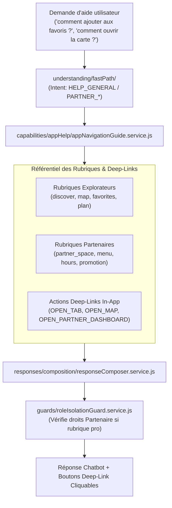

# Architecture du Sous-Système d'Aide, Navigation & Sécurité (`capabilities/appHelp/` & `safety/`)

## 1. Rôle & Objectif Métier

Le sous-système **App Help** (`capabilities/appHelp/`) sert de guide interactif in-app au sein de KharjaBot. Il permet aux utilisateurs (Explorateurs) et aux établissements (Partenaires) d'interroger l'assistant sur le fonctionnement de l'application **Tfarhida**, la navigation vers les écrans clés et la gestion d'établissement, avec déclenchement direct de **Deep-Links mobiles**.

En complément, l'enclave **Safety** (`capabilities/safety/`) et les **Guards** (`guards/`) garantissent la modération souveraine et l'étanchéité entre les rôles Explorateur et Partenaire.

---

## 2. Arborescence Cible du Sous-Système App Help, Safety & Guards

```text
services/chatbot/
│
├── capabilities/
│   ├── appHelp/                                           <-- GUIDE DE NAVIGATION IN-APP & ASSISTANCE PARTENAIRE
│   │   ├── catalogs/
│   │   │   ├── explorerHelpTopics.json                    (Rubriques Explorateur : recherche, carte, favoris, filtres, profil)
│   │   │   ├── partnerHelpTopics.json                     (Rubriques Partenaire : ajout activité, horaires, promos, statistiques)
│   │   │   └── deepLinkActions.contract.json              (Contrat des actions Deep-Link React Native & Web)
│   │   └── appNavigationGuide.service.js                  (Résolution de la rubrique d'aide et génération des boutons Deep-Link)
│   │
│   ├── establishmentInfo/                                 <-- DÉTAILS D'ÉTABLISSEMENT CERTIFIÉS
│   │   └── activityDetailResponder.service.js             (Extraction certifiée : horaires, menu, prix, adresse, WhatsApp)
│   │
│   └── safety/                                            <-- ENCLAVE DE SÉCURITÉ & MODÉRATION (0 LLM)
│       ├── core/                                          (safetyConstants.js, safetyContracts.js, safetyPipeline.js)
│       ├── policies/                                      (inappropriateContent.policy.js, emergencyNumbers.policy.js, offTopicBoundary.policy.js)
│       ├── decision/                                      (safetyPriorityResolver.js, safetyDecision.service.js)
│       ├── responses/                                     (safetyResponseBuilder.js, emergencyCatalog.loader.js)
│       └── chatSafety.service.js                          (Façade d'évaluation de sécurité du tour)
│
└── guards/                                                <-- GARDE-FOUS DE SORTIE POST-GÉNÉRATION
    ├── outputGuard.service.js                             (Garde-fou ultime : anti-fuite PII, validation liens & contrat)
    ├── privacyLeakGuard.service.js                        (Détection Regex PII : tokens JWT, emails privés, clés API)
    ├── roleIsolationGuard.service.js                      (Étanchéité stricte Explorateur vs Données internes Partenaire/Admin)
    └── hallucinationGuard.service.js                      (Vérification que chaque établissement cité provient du grounding MongoDB)
```

---

## 3. Flux d'Exécution d'une Demande d'Aide In-App



---

## 4. Taxonomie des Rubriques & Contrat Deep-Link

### A. Profil Utilisateur / Explorateur
- `discover` : Filtrer par budget, ambiance, ville ou catégorie.
- `map` : Ouvrir la carte interactive autour de sa position GPS.
- `favorites` : Sauvegarder ses adresses préférées dans l'onglet Favoris.
- `plan` : Créer un programme de sortie multi-étapes (ex: Café puis Restaurant).

### B. Profil Établissement / Partenaire
- `partner_space` : Créer et gérer sa fiche établissement depuis le Dashboard Partenaire.
- `partner_hours` : Configurer les horaires d'ouverture hebdomadaires et nocturnes.
- `partner_promotion` : Lancer une promotion, réduction ou happy hour.

### C. Contrat JSON d'Action Deep-Link Mobile
```json
{
  "helpTopic": "map_help",
  "message": {
    "text": "Vous pouvez visualiser tous les établissements autour de vous sur la carte interactive.",
    "actionButtons": [
      {
        "type": "DEEP_LINK",
        "action": "OPEN_INTERACTIVE_MAP",
        "label": "Ouvrir la Carte",
        "payload": { "centerOnUser": true }
      },
      {
        "type": "DEEP_LINK",
        "action": "OPEN_TAB",
        "label": "Explorer les sorties",
        "payload": { "tab": "explore" }
      }
    ]
  }
}
```
