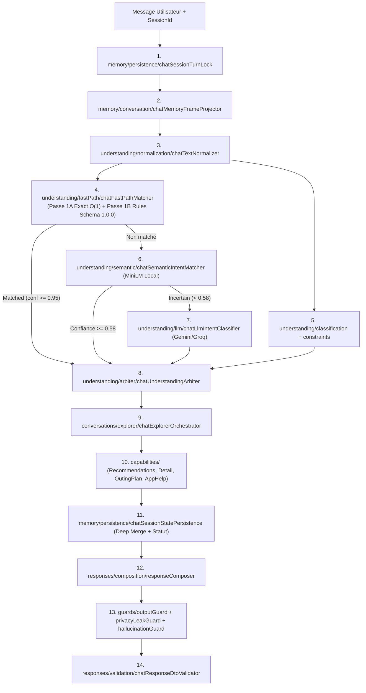

# Architecture Technique & Référence Cible du Chatbot (KharjaBot / Tfarhida AI)

Ce document décrit l'architecture industrielle, modulaire et déterministe-hybride du système conversationnel **KharjaBot** pour la plateforme **Tfarhida (ActivityTN)**. L'architecture sépare strictement :
- L'**Évaluation continue (`benchmarks/`)**
- La **Mémoire Conversationnelle (`memory/`)**
- Les **Capacités Métier & Sécurité (`capabilities/`)**
- La **Compréhension du Sens en 6 étapes (`understanding/`)** : `normalization/` -> `fastPath/` (Exact + Règles Schema 1.0.0) -> `classification/` & `constraints/` -> `semantic/` (MiniLM local) -> `llm/` (Fallback isolé) -> `arbiter/` (Arbitre souverain)
- L'**Orchestration par Rôle (`conversations/`)**
- Les **Garde-fous de Sortie (`guards/`)**
- La **Génération & Composition Multilingue des Réponses (`responses/`)**

---

## 1. Principes Directeurs de l'Architecture

1. **Zéro Poids sur le Bundle Mobile (+0 Mo)** : Toute l'intelligence conversationnelle réside côté serveur (`backend/services/chatbot/`). L'application mobile et le site web n'échangent que des payloads JSON légers (`< 2 Ko`).
2. **Séparation Stricte des Responsabilités (Single Responsibility par Dossier)** :
   - Aucune expression régulière ou règle de compréhension dans les exécuteurs métier ou les constructeurs de réponses.
   - Aucune requête base de données directe dans la couche `understanding/` ou `responses/`.
   - Séparation stricte entre **recherche sémantique locale (`semantic/`)**, **modèle externe (`llm/`)** et **décision finale (`arbiter/`)**.
3. **Pipeline de Compréhension Multi-Étapes (`understanding/`) — Le LLM ne répond jamais directement au client** :
   - **Étape 0 (`normalization/`)** : Nettoyage Unicode, réduction des répétitions, translittération Derja/Arabizi (`3`, `7`, `9`, `5`, `8`), correction de fautes de frappe (distance Damerau-Levenshtein pondérée) et résolution des villes/quartiers tunisiens.
   - **Étape 1 (`fastPath/`)** : Rapprochement ultra-rapide (`< 0.5 ms`) en 2 passes :
     - *Passe 1A (Exact Lookup `O(1)`)* : Table de hachage sur les salutations, mots courts et clics de puces (`fr`, `ar`, `en`, `derja`).
     - *Passe 1B (Pattern Rules `schemaVersion: "1.0.0"`)* : Expressions régulières multilingues pré-compilées au démarrage, triées par `priority DESC` puis `confidence DESC`, extrayant à la fois l'intention (`domain`, `intent`, `subIntent`) et les facettes de contraintes.
   - **Étape 2 (`classification/` & `constraints/`)** : Classification déterministe des actes de dialogue (`dialogueAct`), de la catégorie, de l'ambiance (`vibe`), de l'urgence et extraction structurée des contraintes (`city`, `neighborhood`, `category`, `budgetLevel`, `maxBudget`, `nearMe`, `group`, `situation`, `amenities`, `excluded`).
   - **Étape 3 (`semantic/`)** : Découpage en clauses (`chatClauseSegmenter`), rapprochement sémantique vectoriel 100% local (MiniLM + cosinus TF-IDF) sans aucun appel réseau.
   - **Étape 4 (`llm/`)** : Appelé **uniquement en dernier recours** si les étapes 1 à 3 sont incertaines (`confidence < 0.58`). Le LLM (`Gemini Flash` en n°1 pour la Derja Tounsia, `Groq Llama-3.3` en failover) **ne rédige jamais la réponse** : il renvoie exclusivement un JSON strict validé contre `supportedIntentContract.json`.
   - **Étape 5 (`arbiter/`)** : Arbitre souverain (`chatUnderstandingArbiter`) qui applique les politiques de continuité linguistique et de résolution de `pendingQuestion`, fusionne les contraintes et produit le contrat immuable `turnUnderstanding`.

---

## 2. Arborescence Cible Complète (`services/chatbot/`)

```text
services/chatbot/
│
├── benchmarks/                                            <-- DOSSIER CENTRALISÉ DES BENCHMARKS CHATBOT (TOUTES COUCHES)
│   ├── couche0-normalization/                             (Datasets & runners pour la normalisation, typos, Arabizi/Derja)
│   │   ├── datasets/                                      (noisyInputs.dataset.json, arabiziTunisian.dataset.json)
│   │   └── normalization.benchmark.js
│   ├── couche1-fastpath/                                  (Datasets & runners pour les catalogues FastPath & Règles Schema 1.0.0)
│   │   ├── datasets/                                      (fastPathExactHits.dataset.json, intentRulesMultilingual.dataset.json)
│   │   └── fastPath.benchmark.js
│   ├── couche2-classification/                            (Datasets & runners pour les classifieurs déterministes & contraintes)
│   │   ├── datasets/                                      (intentAndConstraints.dataset.json, ambiguityPairs.json)
│   │   └── classification.benchmark.js
│   ├── couche3-semantic/                                  (Datasets & runners pour MiniLM local & découpage en clauses)
│   │   ├── datasets/                                      (semanticCorpusHoldout.dataset.json, crossDomainHoldout.json)
│   │   └── semanticMatcher.benchmark.js
│   ├── couche4-safety/                                    (Datasets de qualification Safety & Modération hors production)
│   │   ├── datasets/                                      (safetyHoldout.json, falsePositiveQueries.json)
│   │   └── safetyEnclave.benchmark.js
│   ├── couche5-action-planning/                           (Scénarios multi-étapes Café -> Resto -> Loisir, DAG & exécuteur)
│   │   ├── datasets/                                      (multiStepOuting.json, dagTransitions.json)
│   │   └── actionPlanning.benchmark.js
│   ├── couche6-memory/                                    (Tests d'intégrité mémoire multi-tours & Deep Merge)
│   │   ├── datasets/                                      (multiTurnDeepMerge.dataset.json)
│   │   └── memoryIntegrity.benchmark.js
│   ├── couche7-responses/                                 (Benchmarks de la couche réponse, rotation variantes & outputGuard)
│   │   ├── datasets/                                      (variantRotationAndExpansion.dataset.json, piiLeakScenarios.json)
│   │   └── responses.benchmark.js
│   ├── architectureCheck.js                               (ArchitectureGuard : contrôle strict des frontières d'imports)
│   ├── intentGroundTruth.dataset.json                     (Dataset de référence end-to-end multilingue)
│   └── runAllBenchmarks.js                                (Orchestrateur global générant le rapport de performance)
│
├── memory/                                                <-- GESTION CENTRALISÉE DE LA MÉMOIRE, HISTORIQUE & STATUT
│   ├── persistence/
│   │   ├── chatSessionTurnLock.service.js                 (Verrou atomique de tour anti race condition)
│   │   └── chatSessionStatePersistence.service.js         (DEEP MERGE additif récursif + Persistance Session/MongoDB)
│   ├── conversation/
│   │   ├── chatWorkflowStateSchema.service.js             (Contrat canonique de l'état du dialogue & machine à états)
│   │   ├── chatConversationHistory.service.js             (Historique structuré des tours avec troncature intelligente)
│   │   ├── chatMemoryFrameProjector.service.js            (Helper de projection de Frame pour l'orchestrateur)
│   │   └── chatSessionContextMemory.service.js            (SessionContext sanitisé sans PII, contraintes actives & négatives)
│   └── recommendations/
│       ├── chatShownActivitiesMemory.service.js           (Anti-répétition 24h des activités déjà proposées)
│       └── chatResponseUsageMemory.service.js             (Suivi d'entropie des variantes de réponses utilisées)
│
├── capabilities/                                          <-- ACTIONS MÉTIER, WORKFLOWS & SÉCURITÉ SOUVERAINE
│   ├── safety/                                            <-- ENCLAVE DE SÉCURITÉ & MODÉRATION (0 LLM sur contenu sensible)
│   │   ├── core/                                          (safetyConstants, safetyContracts, safetyPipeline)
│   │   ├── policies/                                      (inappropriateContent, emergencyNumbers, offTopicBoundary)
│   │   ├── decision/                                      (safetyPriorityResolver, safetyDecision.service.js)
│   │   ├── responses/                                     (safetyResponseBuilder, emergencyCatalog.loader)
│   │   └── chatSafety.service.js                          (Façade d'évaluation de sécurité du tour)
│   │
│   ├── actionPlanning/                                    <-- 100% LOGIQUE MÉTIER DAG & PLANIFICATION MULTI-ÉTAPES
│   │   ├── chatOutingPlanMemory.service.js                (Helper mémoire DAG pur JS : save, pause, resume, cancel)
│   │   ├── chatOutingPlanGraph.service.js                 (Calcul pur du DAG : Étape 1 Café -> Étape 2 Resto -> Étape 3)
│   │   ├── chatOutingPlanExecutor.service.js              (Orchestration de l'exécution séquentielle des étapes)
│   │   ├── chatOutingPlanEligibility.service.js           (Éligibilité du tour pour une sortie multi-étapes)
│   │   └── chatOutingPlanResponse.service.js              (Construction des réponses localisées de planification)
│   │
│   ├── appHelp/                                           <-- GUIDE DE NAVIGATION IN-APP & ASSISTANCE PARTENAIRE
│   │   └── appNavigationGuide.service.js                  (Résolution des rubriques d'aide et deep-links mobiles)
│   │
│   ├── establishmentInfo/                                 <-- DÉTAILS D'ÉTABLISSEMENT CERTIFIÉS
│   │   └── activityDetailResponder.service.js             (Extraction certifiée : horaires, menu, prix, adresse, WhatsApp)
│   │
│   ├── recommendations/                                   <-- MOTEUR DE RECHERCHE MONGODB, RANKING & RELAXATION
│   │   ├── activityQueryBuilder.service.js                (Construction de requêtes MongoDB indexées & géo-filtrées)
│   │   ├── activityRanker.service.js                      (Scoring composite : proximité, match équipements, note, promo)
│   │   ├── activityRepository.mongo.js                    (Accès base de données isolé)
│   │   ├── fallbackRelaxation.service.js                  (Relaxation progressive des critères si 0 résultat exact)
│   │   ├── chatCardFormatter.service.js                   (Formatage DTO des cartes d'activités pour le mobile)
│   │   └── chatRecommendationBridge.service.js            (Pont d'orchestration de la recommandation)
│   │
│   └── suggestions/                                       <-- SUGGESTIONS CONTEXTUELLES POST-RÉPONSE
│       └── contextualSuggestions.service.js
│
├── understanding/                                         <-- COMPRÉHENSION DU SENS (DÉCOUPAGE STRICT EN 6 ÉTAPES)
│   ├── normalization/                                     (Étape 0 : Nettoyage Unicode, répétitions, typo Damerau, Arabizi)
│   │   ├── catalogs/                                      (Catalogues de normalisation par langue)
│   │   │   ├── fr/
│   │   │   │   ├── typoDictionary.json                    (Dictionnaire de fautes de frappe françaises)
│   │   │   │   ├── phraseAliases.json                     (Alias & équivalences de phrases FR)
│   │   │   │   └── domainKeywordsWhitelist.json           (Mots-clés protégés du domaine FR)
│   │   │   ├── en/
│   │   │   │   └── typoDictionary.json                    (Dictionnaire de fautes de frappe anglaises)
│   │   │   ├── arabizi/
│   │   │   │   └── tunisianDerjaDictionary.json           (Translittération Arabizi chiffres 3, 5, 7, 9 & lexique Derja)
│   │   │   ├── geo/
│   │   │   │   ├── tunisiaCitiesAliases.json              (Villes tunisiennes & variantes orthographiques)
│   │   │   │   └── sfaxNeighborhoods.json                 (Quartiers & zones locales : Gremda, Chihia, La Marsa...)
│   │   │   ├── shared/
│   │   │   │   └── immutableTokens.json                   (Tokens stricts non modifiables : acronymes, numéros, marques)
│   │   │   └── schema/
│   │   │       └── normalizationCatalog.schema.json       (Validation du format de catalogue)
│   │   ├── fuzzy/
│   │   │   ├── keyboardAdjacency.js                       (Matrice de proximité clavier AZERTY/QWERTY)
│   │   │   └── weightedDamerauLevenshtein.js              (Distance d'édition pondérée anti faux-positifs)
│   │   ├── loaders/
│   │   │   └── normalizationCatalog.loader.js             (Chargeur unifié avec cache mémoire)
│   │   ├── arabicMorphology.service.js                    (Normalisation morphologique arabe : Alif, Ya, Ta Marbuta, préfixes)
│   │   └── chatTextNormalizer.service.js                  (Pipeline complet Étape 0)
│   │
│   ├── fastPath/                                          (Étape 1 : Rapprochement rapide < 0.5 ms — Exact O(1) + Règles Schema 1.0.0)
│   │   ├── catalogs/                                      (Catalogues décomposés FR / EN / AR / DERJA + Règles Schema 1.0.0)
│   │   │   ├── fr/                                        (common.json, discovery.json, partner.json + sous-domaines)
│   │   │   ├── en/                                        (common.json + sous-domaines miroirs)
│   │   │   ├── ar/                                        (common.json + sous-domaines miroirs)
│   │   │   ├── derja/                                     (common.json + sous-domaines miroirs)
│   │   │   ├── rules/                                     (Règles déclaratives multilingues unifiées SchemaVersion 1.0.0)
│   │   │   │   └── intentRules.v1.json                    (Règles compilées avec domain, intent, subIntent, priority, patterns)
│   │   │   └── supportedIntentContract.json               (Contrat d'intégrité taxonomique des intentions)
│   │   ├── loaders/
│   │   │   └── fastPathCatalog.loader.js                  (Chargeur composite : Map O(1) + RegExp pré-compilées triées par priorité)
│   │   └── chatFastPathMatcher.service.js                 (Exécuteur FastPath : Passe 1A Exact 0 ms -> Passe 1B Pattern Rules < 0.4 ms)
│   │
│   ├── classification/                                    (Étape 2 : Classifieurs déterministes de dialogue & facettes)
│   │   ├── chatActivityCategoryClassifier.service.js      (Classification des catégories d'activités)
│   │   ├── chatDialogueActClassifier.service.js           (Classification des actes de dialogue : SEARCH, REFINEMENT, RESET...)
│   │   ├── chatVibeAndAudienceClassifier.service.js       (Détection d'ambiance : calme, festif, cosy, vue mer)
│   │   ├── chatTimeUrgencyClassifier.service.js           (Détection temporelle : maintenant, ce soir, ce week-end)
│   │   ├── classificationDto.builder.js                   (Constructeur du DTO standardisé de classification)
│   │   └── chatClassification.facade.js                   (Façade unifiée Étape 2)
│   │
│   ├── constraints/                                       (Étape 2b : Parsing des contraintes de sortie & entités numériques)
│   │   └── chatOutingConstraints.service.js               (Extraction : maxBudget en DT, nearMe, ville, quartier, groupe, négations)
│   │
│   ├── semantic/                                          (Étape 3 : Recherche Sémantique Locale par Embeddings MiniLM — 0 Appel Réseau)
│   │   ├── config/
│   │   │   └── semanticThresholds.config.js               (Seuils cosinus 0.58/0.75, marges d'ambiguïté, topK)
│   │   ├── corpus/
│   │   │   └── semanticIntentCorpus.json                  (Corpus d'ancres sémantiques multilingues FR/EN/AR/Derja)
│   │   ├── chatClauseSegmenter.service.js                 (Découpage en propositions grammaticales pour sorties multi-étapes)
│   │   ├── chatMiniLmEmbedder.service.js                  (Moteur d'embeddings local ONNX / MiniLM + TF-IDF)
│   │   └── chatSemanticIntentMatcher.service.js           (Calcul pur de similarité cosinus & marge inter-intentions)
│   │
│   ├── llm/                                               (Étape 4 : Fallback Classifieur d'Intention LLM — Isolé & Dernier Recours)
│   │   └── chatLlmIntentClassifier.service.js             (Gemini Flash / Groq : classification JSON stricte, 0 rédaction libre)
│   │
│   └── arbiter/                                           (Étape 5 : Arbitre Souverain Multi-Couches & Contrat Canonique)
│       ├── contracts/
│       │   └── turnUnderstanding.contract.js              (Contrat immuable final `turnUnderstanding`)
│       └── chatUnderstandingArbiter.service.js            (Arbitre final : FastPath [1] -> Classification [2] -> MiniLM [3] -> LLM [4])
│
├── conversations/                                         <-- ORCHESTRATION MÉTIER DES CONVERSATIONS
│   ├── explorer/
│   │   ├── chatExplorerOrchestrator.service.js            (Orchestrateur Explorateur central)
│   │   └── chatExplorerIntentRouter.service.js            (Aiguillage des intentions : static, discover, detail, plan)
│   ├── partner/
│   │   └── chatPartnerOrchestrator.service.js             (Orchestrateur d'assistance Partenaire)
│   └── chatMainGateway.service.js                         (Point d'entrée unique : TurnLock -> Understanding -> Orchestrator -> Guards)
│
├── guards/                                                <-- GARDE-FOUS DE SORTIE POST-GÉNÉRATION
│   ├── outputGuard.service.js                             (Garde-fou ultime : anti-fuite PII, validation liens & contrat)
│   ├── privacyLeakGuard.service.js                        (Détection Regex PII : tokens JWT, emails privés, clés API)
│   └── hallucinationGuard.service.js                      (Vérification que chaque établissement cité provient du grounding MongoDB)
│
└── responses/                                             <-- GÉNÉRATION & COMPOSITION MULTILINGUE DES RÉPONSES
    ├── catalog/                                           (Catalogues déclaratifs symétriques FR / EN / AR / DERJA)
    │   ├── fr/
    │   ├── en/
    │   ├── ar/
    │   ├── derja/
    │   └── catalogLoader.js
    ├── resolution/                                        (responseResolver, antiRepetitionVariantSelector, variableInterpolator)
    ├── dynamicPool/                                       (dynamicResponseStore, llmVariantGenerator, responseUsageTracker)
    ├── suggestions/                                       (smartSuggestionsEngine.service.js)
    ├── composition/                                       (responseComposer.service.js, quickRepliesBuilder.service.js)
    └── validation/                                        (chatResponseDtoValidator.service.js)
```

---

## 3. Flux d'Exécution d'un Tour de Conversation (Dataflow)



---

## 4. Contrat Canonique `turnUnderstanding` (`understanding/arbiter/contracts/`)

```javascript
{
  intent: "DISCOVER_ACTIVITIES",          // Intention canonique du contrat
  confidence: 0.99,                       // Score de confiance [0.0 - 1.0]
  source: "fastPath_rule",                // "fastPath" | "fastPath_rule" | "classification" | "semantic_minilm" | "llm_intent_classifier"
  language: "fr",                         // "fr" | "ar" | "derja" | "en"
  dialogueAct: "SEARCH_REQUEST",          // "SEARCH_REQUEST" | "REFINEMENT" | "RESET" | "AFFIRMATION" | "OTHER"
  ruleMetadata: {                         // Métadonnées issues du schéma 1.0.0 (si matché par règle)
    ruleId: "tf-place-discovery-cafes-001",
    domain: "PLACE_DISCOVERY",
    intent: "search_places",
    subIntent: "cafes",
    category: "PLACE_DISCOVERY",
    subcategory: "cafes"
  },
  constraints: {
    city: "Sfax",
    cities: ["Sfax"],
    neighborhood: "Gremda",
    neighborhoods: ["Gremda"],
    category: "cafe",
    categories: ["cafe"],
    budgetLevel: "low",                   // "low" | "medium" | "high" | null
    maxBudget: 20,                        // Montant numérique extrait (ex: "20 dt")
    nearMe: true,                         // Proximité GPS demandée ("près de moi", "7dheya")
    situation: "open_now",                // "open_now" | "cold" | "rain" | "hot" | null
    group: "friends",                     // "couple" | "friends" | "family" | null
    mood: null,
    amenities: ["calme"],
    excluded: {
      amenities: [],
      categories: []
    }
  },
  vibes: ["chill"],
  urgency: "now",
  segments: ["je cherche un cafe calme avec mes amis moins de 20dt"],
  normalizedText: "je cherche un cafe calme avec mes amis moins de 20dt"
}
```

---

## 5. Règles d'Étanchéité (`ArchitectureGuard`)

Le fichier [`benchmarks/architectureCheck.js`](file:///c:/AT/backend/services/chatbot/benchmarks/architectureCheck.js) vérifie automatiquement à chaque lancement :
1. **`understanding/`** est 100% pure : aucun import depuis `/capabilities/`, `/conversations/` ou `/models/Activity`.
2. **`capabilities/`** ne dépend jamais de `/conversations/`.
3. **`responses/`** ne lit jamais la base de données ni `/capabilities/`.
4. **`guards/`** est constituée de fonctions pures indépendantes de `/capabilities/` et `/conversations/`.
