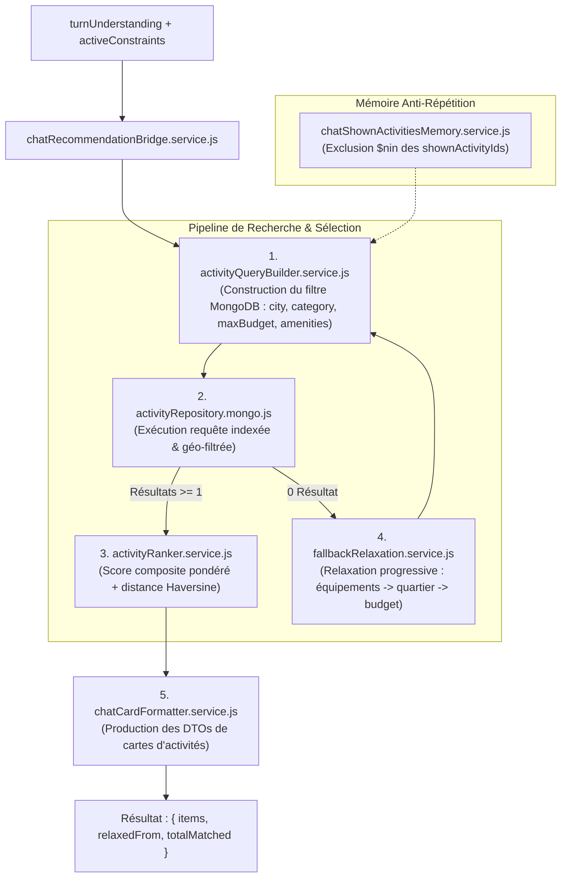

# Architecture du Sous-Système de Recommandation d'Activités (`capabilities/recommendations/`)

## 1. Rôle & Objectif Métier

Le sous-système de recommandation (`capabilities/recommendations/`) transforme le contrat `turnUnderstanding` et la mémoire de session (`activeConstraints`, `shownActivityIds`) en une sélection ordonnée, diversifiée et personnalisée d'activités réelles issues de la base MongoDB **Tfarhida**.

---

## 2. Arborescence du Sous-Système Recommandation & Planification

```text
services/chatbot/
│
├── capabilities/
│   ├── recommendations/                                   <-- MOTEUR DE RECHERCHE MONGODB, RANKING & RELAXATION
│   │   ├── activityQueryBuilder.service.js                (Construction du filtre MongoDB indexé : ville, quartier, catégorie, budget, équipements)
│   │   ├── activityRanker.service.js                      (Scoring composite : proximité GPS, match équipements, note, promo, fraîcheur)
│   │   ├── activityRepository.mongo.js                    (Couche d'accès isolée au modèle Mongoose Activity)
│   │   ├── fallbackRelaxation.service.js                  (Relaxation progressive en 3 paliers si 0 résultat strict)
│   │   ├── chatCardFormatter.service.js                   (Formatage DTO des cartes d'activités pour React Native & Web)
│   │   └── chatRecommendationBridge.service.js            (Pont d'orchestration principal de la recommandation)
│   │
│   └── actionPlanning/                                    <-- PLANIFICATION DE SORTIE MULTI-ÉTAPES (DAG)
│       ├── chatOutingPlanEligibility.service.js           (Détection d'éligibilité d'un plan séquentiel Café -> Resto -> Loisir)
│       ├── chatOutingPlanGraph.service.js                 (Construction du graphe orienté acyclique DAG des étapes)
│       ├── chatOutingPlanExecutor.service.js              (Exécution étape par étape avec recommandations dédiées par nœud)
│       ├── chatOutingPlanMemory.service.js                (Persistance de l'état du plan : save, pause, resume, cancel)
│       └── chatOutingPlanResponse.service.js              (Formatage localisé FR/AR/Derja/EN du parcours multi-étapes)
│
└── memory/
    └── recommendations/                                   <-- MÉMOIRE D'ANTI-RÉPÉTITION
        ├── chatShownActivitiesMemory.service.js           (Exclusion des IDs d'activités déjà présentées sur 24h)
        └── chatResponseUsageMemory.service.js             (Rotation anti-répétition des variantes de textes)
```

---

## 3. Flux d'Exécution du Pipeline de Recommandation



---

## 4. Détail des Composants Techniques

### 1. `activityQueryBuilder.service.js`
Construit la requête MongoDB en exploitant les contraintes fusionnées :
- **Statut** : Uniquement les établissements publiés et actifs.
- **Géographie (`city`, `neighborhood`, `nearMe`)** :
  - Filtre par ville et quartier (avec support des alias : *La Marsa*, *Sfax*, *Gremda*, *Chihia*, *Sakiet Ezzit*).
  - Si `nearMe: true` et que `userContext.coords` est présent, applique un rayon de proximité prioritaire.
- **Catégories (`categories`)** : Filtre `$in` sur les catégories normalisées (`cafe`, `restaurant`, `salon_de_the`, `loisir`, `sport`, `culture`).
- **Budget (`budgetLevel`, `maxBudget`)** :
  - Si `maxBudget` est renseigné (ex: `20` extrait de *"moins de 20 dt"*), filtre `price <= maxBudget`.
  - Sinon applique le palier `budgetLevel` (`low`, `medium`, `high`).
- **Équipements & Exclusions (`amenities`, `excluded`)** :
  - `$all` sur les équipements requis (`calme`, `terrasse`, `wifi`, `vue_mer`, `parking`).
  - `$nin` sur `excluded.amenities` (ex: *"sans chicha"*).

### 2. `activityRanker.service.js` (Formule de Scoring Composite)
Chaque activité candidate reçoit un score calculé selon la formule pondérée :

$$\text{Score} = 0.35 \cdot S_{\text{geo}} + 0.30 \cdot S_{\text{match}} + 0.15 \cdot S_{\text{pop}} + 0.10 \cdot S_{\text{promo}} + 0.10 \cdot S_{\text{fresh}}$$

- $S_{\text{geo}}$ (**35%**) : Proximité physique inverse de la distance kilométrique (si GPS actif).
- $S_{\text{match}}$ (**30%**) : Correspondance exacte avec l'ambiance, le groupe (`friends`, `couple`, `family`) et les équipements.
- $S_{\text{pop}}$ (**15%**) : Note moyenne des avis vérifiés et popularité.
- $S_{\text{promo}}$ (**10%**) : Bonus pour les établissements ayant une offre promotionnelle active.
- $S_{\text{fresh}}$ (**10%**) : Diversité contrôlée pour renouveler les découvertes.

### 3. `fallbackRelaxation.service.js` (Relaxation Progressive sans Impasse)
Si la requête stricte retourne 0 établissement :
1. **Palier 1 (Relax `amenities`)** : Conserve ville + quartier + catégorie + budget, mais assouplit les équipements secondaires.
2. **Palier 2 (Relax `neighborhood`)** : Élargit la recherche du quartier précis vers toute la ville (ex: de *Sakiet Ezzit* vers tout *Sfax*) avec un message explicite dans la langue de l'utilisateur.
3. **Palier 3 (Relax `budgetLevel`)** : Élargit la tranche tarifaire tout en conservant la catégorie et la ville.
