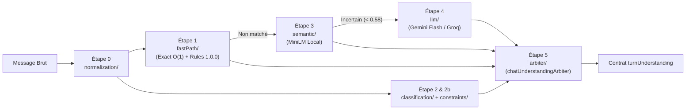

# Architecture de la Couche de Compréhension (`understanding/`) & Moteur de Règles d'Intentions (`Schema 1.0.0`)

## 1. Vue d'Ensemble en 6 Étapes Séquentielles

La couche `backend/services/chatbot/understanding/` transforme un message brut multilingue (Français, Anglais, Arabe standard, Derja tunisienne / Arabizi) en un objet structuré et immuable `turnUnderstanding`.



---

## 2. Spécification du Schéma Déclaratif `schemaVersion: "1.0.0"` (`fastPath/catalogs/rules/intentRules.v1.json`)

Chaque règle déclarative respecte le contrat JSON suivant :

```json
{
  "schemaVersion": "1.0.0",
  "rules": [
    {
      "id": "tf-place-discovery-cafes-001",
      "domain": "PLACE_DISCOVERY",
      "intent": "search_places",
      "subIntent": "cafes",
      "category": "PLACE_DISCOVERY",
      "subcategory": "cafes",
      "confidence": 0.99,
      "priority": 10,
      "status": "active",
      "patterns": [
        "\\b(caf[eé]s?|coffee shops?|cafeterias?)\\b",
        "\\b(je cherche|je veux|trouve[- ]moi|donne[- ]moi|propose[- ]moi)\\b.{0,35}\\b(caf[eé]|coffee shop|kahwa|9ahwa)\\b",
        "\\b(find me|i want|show me|looking for)\\b.{0,35}\\b(caf[eé]|coffee shop|coffee|cafe)\\b",
        "(أبحث عن|ابحث عن|أريد|اريد|اعطني|أعطني|اقترح علي).{0,35}(مقهى|قهوة|كافيه)",
        "\\b(nlawwej|lawwejli|nheb|a3tini|3tini|9olli)\\b.{0,35}\\b(9ahwa|kahwa|cafe|caf[eé])\\b",
        "\\b(win|where|ou)\\b.{0,25}\\b(n9ahwi|nchri|nechri|kahwa|9ahwa)\\b"
      ],
      "patternFlags": ["i", "i", "i", "i", "i", "i"]
    }
  ]
}
```

### Table de Correspondance vers le Contrat Canonique (`turnUnderstanding`)

| `id` | `domain` | `intent` / `subIntent` | `canonicalIntent` | Contraintes Extraites (`constraints`) |
| :--- | :--- | :--- | :--- | :--- |
| `tf-place-discovery-cafes-001` | `PLACE_DISCOVERY` | `search_places` / `cafes` | `DISCOVER_ACTIVITIES` | `categories: ["cafe"]` |
| `tf-place-discovery-restaurants-001` | `PLACE_DISCOVERY` | `search_places` / `restaurants` | `DISCOVER_ACTIVITIES` | `categories: ["restaurant"]` |
| `tf-place-discovery-lounges-001` | `PLACE_DISCOVERY` | `search_places` / `lounges` | `DISCOVER_ACTIVITIES` | `categories: ["salon_de_the"]` |
| `tf-outing-planning-friends-001` | `OUTING_PLANNING` | `plan_outing` / `with_friends` | `DISCOVER_ACTIVITIES` | `group: "friends"` |
| `tf-budget-max-001` | `BUDGET_AND_DEALS` | `filter_by_budget` / `maximum_budget` | `DISCOVER_ACTIVITIES` | `budgetLevel: "low"`, `maxBudget: <number>` |
| `tf-location-nearby-001` | `LOCATION_AND_NAVIGATION` | `search_nearby` / `near_current_location` | `DISCOVER_ACTIVITIES` | `nearMe: true` |
| `tf-atmosphere-quiet-001` | `ATMOSPHERE_AND_PREFERENCES` | `filter_by_atmosphere` / `quiet` | `DISCOVER_ACTIVITIES` | `amenities: ["calme"]` |
| `tf-availability-open-now-001` | `AVAILABILITY_AND_HOURS` | `check_open_status` / `open_now` | `ASK_OPENING_HOURS` / `DISCOVER_ACTIVITIES` | `situation: "open_now"` |
| `tf-contact-whatsapp-001` | `CONTACT_AND_RESERVATION` | `contact_establishment` / `whatsapp` | `ASK_CONTACT_OR_SOCIAL` | — |
| `tf-personalized-recommendation-001` | `PERSONALIZED_RECOMMENDATION` | `get_recommendations` / `personalized` | `DISCOVER_ACTIVITIES` | — |
| `tf-chat-greeting-001` | `CHAT_AND_ASSISTANCE` | `greeting` / `hello` | `GREETING` | — |

---

## 3. Séparation `semantic/` vs `llm/` vs `arbiter/`

1. **`understanding/semantic/` (Étape 3 — 100% Local)** :
   - Contient uniquement le découpage en clauses (`chatClauseSegmenter.service.js`), l'embedder local (`chatMiniLmEmbedder.service.js`) et le matcher cosinus (`chatSemanticIntentMatcher.service.js`).
   - Zéro dépendance réseau, latence < 10 ms.
2. **`understanding/llm/` (Étape 4 — Dernier Recours Externe)** :
   - Contient `chatLlmIntentClassifier.service.js`.
   - Isolé avec timeout strict, température 0 et validation du JSON contre `supportedIntentContract.json`.
3. **`understanding/arbiter/` (Étape 5 — Décision Finale)** :
   - Contient `chatUnderstandingArbiter.service.js` et `contracts/turnUnderstanding.contract.js`.
   - Agrège les résultats des étapes 1, 2, 3 et 4 pour construire le `turnUnderstanding` final.
