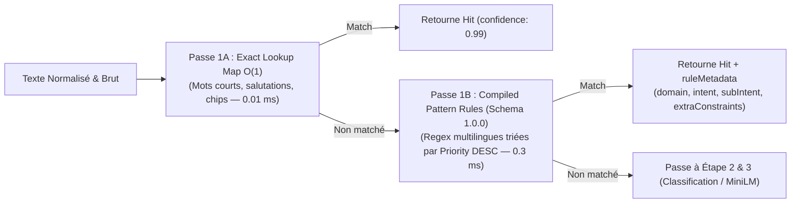

# Analyse d'Écart (Gap Analysis) & Recommandations de Correction Architecturale

Ce document compare l'état actuel de `backend/services/chatbot/` avec l'**Architecture Cible de Référence** et détaille les recommandations concrètes pour aligner le code à 100%.

---

## 1. Tableau Comparatif : État Actuel vs Architecture Cible

| Couche / Module | État Actuel (`services/chatbot/`) | Architecture Cible Recommandée | Priorité de Correction |
| :--- | :--- | :--- | :--- |
| **`understanding/fastPath/`** | Simple égalité stricte `exactLookup.get(candidate)` sur quelques phrases plates (`common.json`, `discovery.json`). | **FastPath Hybride (O(1) + Règles Regex Schema 1.0.0)** avec `priority`, `confidence`, `domain`, `intent`, `subIntent` et catalogues symétriques par domaine (`explorer/`, `partner/`). | **P0 (Critique)** |
| **`understanding/constraints/`** | Listes de mots-clés figées dans le code JS (`includesAny` dans `chatOutingConstraints.service.js`), absence d'extraction du budget chiffré (`20 dt`). | Extraction structurée combinant les règles déclaratives (montant max en dinars `([0-9]+)\s*(dt\|tnd\|dinars)`, proximité `nearMe`, groupe, ambiance). | **P0 (Critique)** |
| **`understanding/classification/`** | Fichiers posés à plat dans `classification/`. | Structuration claire en sous-dossiers `shared/`, `explorer/`, `partner/` + façade `chatClassification.facade.js`. | **P1 (Haute)** |
| **`understanding/semantic/`** | Mélange 3 responsabilités différentes dans un même dossier : MiniLM local, appel réseau LLM externe (`chatLlmIntentClassifier.service.js`) et l'arbitre global (`chatUnderstandingArbiter.service.js`). | **Séparation stricte en 3 dossiers dédiés** : 1. `semantic/` (Étape 3 : Embeddings locaux MiniLM & similarité cosinus) 2. `llm/` (Étape 4 : Fallback LLM isolé avec circuit-breaker, providers Gemini/Groq et validation JSON) 3. `arbiter/` (Étape 5 : Arbitre souverain multi-couches & contrat `turnUnderstanding`). | **P0 (Critique)** |
| **`capabilities/safety/`** | Absent (uniquement `guards/outputGuard.service.js` en sortie). | Enclave dédiée `capabilities/safety/` en entrée pour filtrer les contenus inappropriés, urgences ou hors-sujet strict avant tout appel métier/LLM. | **P1 (Haute)** |
| **`capabilities/appHelp/`** | Fichier minimaliste de 9 lignes (`appNavigationGuide.service.js`). | Service complet de guidage in-app retournant des explications multilingues et des boutons d'action **Deep-Links** (`OPEN_MAP`, `OPEN_TAB`, `OPEN_PARTNER_DASHBOARD`). | **P1 (Haute)** |
| **`guards/`** | Un seul fichier `outputGuard.service.js`. | Séparation en 3 gardes spécialisés : `outputGuard.service.js`, `privacyLeakGuard.js` (anti-fuite PII/tokens), `roleIsolationGuard.js` (étanchéité Explorateur vs Partenaire). | **P2 (Moyenne)** |
| **`benchmarks/`** | 6 couches de tests (`couche0` à `couche5` + `architectureCheck.js`). | 8 couches complètes incluant `couche4-safety` et `couche5-action-planning` (tests DAG multi-étapes). | **P2 (Moyenne)** |

---

## 2. Recommandation Majeure : Pourquoi intégrer les Règles (`Schema 1.0.0`) dans `fastPath/` (et non dans un dossier `rules/` séparé) ?

### Le Problème d'un dossier `rules/` séparé :
Si l'on crée un dossier `understanding/rules/` à côté de `understanding/fastPath/` et `understanding/classification/`, on fragmente la logique déterministe en **3 étapes redondantes** :
1. `fastPath` cherche dans ses JSON.
2. `rules` cherche dans d'autres JSON avec des Regex.
3. `classification` cherche dans des tableaux JS avec `includesAny`.

### La Solution Recommandée (Alignée sur l'Architecture Cible) :
Faire évoluer **`understanding/fastPath/`** pour qu'il soit l'unique moteur de rapprochement rapide déterministe (Étape 1), fonctionnant en deux passes ultra-rapides :

#### Avantages immédiats :
1. **Zéro duplication d'architecture** : On conserve exactement les 4 piliers de `understanding/` (`normalization/`, `fastPath/`, `classification/`, `constraints/`, `semantic/`).
2. **Puissance du Schema 1.0.0 dans `fastPath`** :
   - `fastPathCatalog.loader.js` charge à la fois les listes de phrases exactes ET les fichiers de règles au format `schemaVersion: "1.0.0"` (`patterns`, `patternFlags`, `priority`, `confidence`, `domain`, `intent`, `subIntent`).
   - Toutes les `RegExp` sont compilées une seule fois au démarrage (`new RegExp(pattern, flags)`).
3. **Extraction multi-facettes** :
   - Lorsqu'une phrase comme *"je cherche un café calme avec mes amis moins de 20dt"* passe dans `fastPath`, la règle principale `tf-place-discovery-cafes-001` identifie l'intention, tandis que les règles de contraintes (`tf-atmosphere-quiet-001`, `tf-outing-planning-friends-001`, `tf-budget-max-001`) enrichissent directement les facettes du tour.

---

## 3. Plan d'Action Recommandé (Ordre de Migration Sans Régression)

### Étape 1 : Enrichissement de `understanding/fastPath/` (Priorité 1)
1. Ajouter le support natif du format `schemaVersion: "1.0.0"` dans `understanding/fastPath/loaders/fastPathCatalog.loader.js` :
   - Compilation et mise en cache des `patterns` regex avec `patternFlags`.
   - Tri automatique des règles `status === "active"` par `priority DESC` puis `confidence DESC`.
   - Table de mapping vers les intentions canoniques du contrat (`supportedIntentContract.json`).
2. Organiser les catalogues dans `understanding/fastPath/catalogs/` :
   - Intégrer les règles `PLACE_DISCOVERY` (cafés, restaurants, lounges), `OUTING_PLANNING` (amis, couple, famille), `BUDGET_AND_DEALS` (budget max en DT), `LOCATION_AND_NAVIGATION` (près de moi), `ATMOSPHERE_AND_PREFERENCES` (calme), `AVAILABILITY_AND_HOURS` (ouvert maintenant), `CONTACT_AND_RESERVATION` (whatsapp), `PERSONALIZED_RECOMMENDATION`, `CHAT_AND_ASSISTANCE`.
3. Mettre à jour `chatFastPathMatcher.service.js` pour exécuter :
   - Passe 1A : `exactLookup` (0.01 ms).
   - Passe 1B : `compiledRules` (< 0.4 ms) avec extraction de toutes les règles matchées (intention primaire + sous-intentions de contraintes).

### Étape 2 : Connexion avec `constraints/` et `chatUnderstandingArbiter.service.js` (Priorité 1)
1. Dans `chatOutingConstraints.service.js` :
   - Ajouter l'extraction du montant numérique maximal (`maxBudget: 20` pour *"20dt"* / *"20 dinars"*) et du flag `nearMe: true` (*"près de moi"*, *"7dheya"*).
2. Dans `chatUnderstandingArbiter.service.js` :
   - Propager `ruleMetadata` (`ruleId`, `domain`, `intent`, `subIntent`, `category`, `subcategory`) dans le `turnUnderstanding` tout en conservant l'intention canonique attendue par l'orchestrateur.

### Étape 3 : Enrichissement de `capabilities/appHelp/` (Priorité 2)
1. Étendre `appNavigationGuide.service.js` avec les rubriques détaillées Explorateur & Partenaire et les actions `deepLink` pour l'application mobile React Native.

### Étape 4 : Structuration de `guards/` et `benchmarks/` (Priorité 2)
1. Découper `guards/` en `outputGuard.service.js`, `privacyLeakGuard.js` et `roleIsolationGuard.js`.
2. Ajouter les scénarios de test des nouvelles règles multilingues (FR, EN, AR, Derja) dans `benchmarks/couche1-fastpath/fastPath.benchmark.js`.

