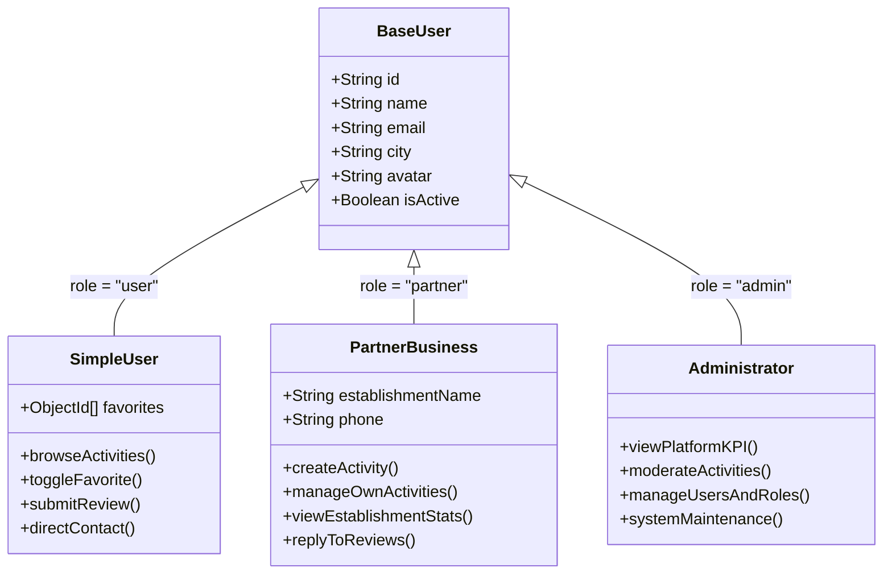
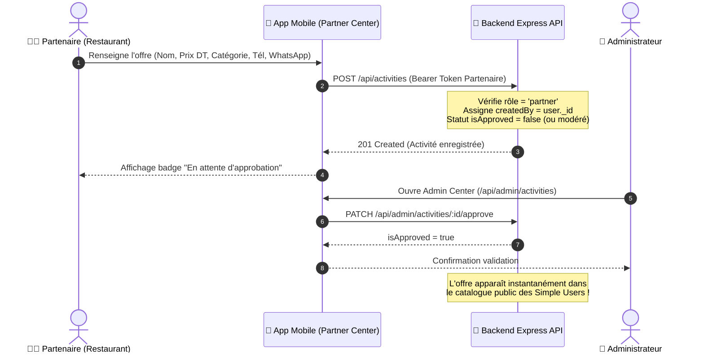

# Architecture des 3 Types d'Utilisateurs & Cas Partenaire Établissement (ex: Restaurant)

## 1. Vue d'Ensemble des 3 Profils

La plateforme **ActivityTN** segmente ses utilisateurs en trois catégories étanches régies par le modèle de sécurité **RBAC (Role-Based Access Control)** :



---

## 2. Matrice Comparative des Permissions RBAC

| Fonctionnalité / Droit | Simple User (`user`) | Partenaire Pro (`partner`) *(ex: Restaurant)* | Administrateur (`admin`) |
| :--- | :---: | :---: | :---: |
| **Consulter le catalogue public** | ✅ Oui | ✅ Oui | ✅ Oui |
| **Ajouter des favoris synchronisés** | ✅ Oui | ✅ Oui | ✅ Oui |
| **Laisser un avis et une note** | ✅ Oui | ✅ Oui | ✅ Oui |
| **Accès à l'Espace Partenaire Pro** | ❌ Non | ✅ **Oui** | ✅ Oui |
| **Créer des activités pour son établissement** | ❌ Non (403) | ✅ **Oui** *(Ses offres)* | ✅ Oui *(Toutes)* |
| **Modifier / Mettre à jour ses offres** | ❌ Non (403) | ✅ **Oui** *(Ses offres)* | ✅ Oui *(Toutes)* |
| **Supprimer ses propres offres** | ❌ Non (403) | ✅ **Oui** *(Ses offres)* | ✅ Oui *(Toutes)* |
| **Accès au Panneau d'Administration Général**| ❌ Non (403) | ❌ Non (403) | ✅ **Oui** |
| **Modérer les activités (Approuver/Rejeter)**| ❌ Non (403) | ❌ Non (403) | ✅ **Oui** |
| **Mettre en avant (Featured ⭐ / Populaire 🔥)**| ❌ Non (403) | ❌ Non (403) | ✅ **Oui** |
| **Suspendre / Réactiver des comptes tiers** | ❌ Non (403) | ❌ Non (403) | ✅ **Oui** |
| **Modifier les rôles des utilisateurs** | ❌ Non (403) | ❌ Non (403) | ✅ **Oui** |
| **Consulter les KPI globaux de la plateforme** | ❌ Non (403) | ❌ Non (403) | ✅ **Oui** |

---

## 3. Cas Concret : Le Partenaire Établissement (ex: Propriétaire d'un Restaurant)

### 3.1. Problématique Métier
Un restaurateur (par exemple à Sfax ou Sidi Bou Saïd) possède un compte avec le rôle `partner` rattaché à son établissement `establishmentName: "Restaurant Le Pirate"`.

Il a besoin de :
1. **Publier des activités/offres** : Déjeuner en terrasse, dîner gastronomique fruits de mer, formule brunch du dimanche, soirée musicale.
2. **Fournir les détails pratiques** : Prix moyen par personne (DT), coordonnées directes (téléphone, WhatsApp), présence de climatisation et de groupe électrogène en cas de coupure.
3. **Suivre la performance** : Connaître sa note moyenne, lire les avis des clients et vérifier si ses offres sont approuvées par l'équipe de modération.

### 3.2. Cycle de Vie d'une Offre Partenaire



### 3.3. Contrôle Strict de Propriété (`Ownership Check`)
Dans `backend/services/activity.service.js`, la sécurité garantit qu'un partenaire **ne peut jamais altérer les activités d'un restaurant concurrent** :
```javascript
// Si ce n'est pas un admin, l'utilisateur doit obligatoirement être le créateur de l'activité
if (user.role !== "admin" && activity.createdBy?.toString() !== user.id) {
  const error = new Error("Accès refusé : vous ne pouvez modifier que vos propres activités.");
  error.statusCode = 403;
  throw error;
}
```
