# Architecture Technique Actuelle de la Plateforme ActivityTN

## 1. Vue d'Ensemble & Vision du Système

**ActivityTN** est une plateforme omnicanale dédiée à la découverte, la recommandation et la promotion des activités de loisirs, de restauration et de culture en Tunisie (Tunis, Sfax, Sousse, Djerba, Monastir, Bizerte, Tozeur, etc.).

La plateforme adopte une architecture client-serveur moderne, découplée et hautement modulaire :
- **Client Mobile & Web** : Développé en React Native avec le framework **Expo SDK 54**, compatible Android, iOS et Web, typé en TypeScript strict.
- **Backend API & Services** : Micro-framework **Express.js (Node.js)** en modules ES6, persistance NoSQL via **MongoDB / Mongoose**, avec couche de sécurité Zero-Trust (RBAC, Rate Limiting, ReDoS escaping, validation des flux entrants).

```mermaid
graph TB
    subgraph Clients["Clients Multi-Plateformes"]
        MobileAndroid["📱 Android App (Expo Go / APK)"]
        MobileiOS["🍏 iOS App (Expo Go / IPA)"]
        WebBrowser["🌐 Web Client (React Native Web)"]
    end

    subgraph SecurityLayer["Couche de Sécurité & Passerelle API"]
        Helmet["🛡️ Helmet HTTP Security Headers"]
        Cors["🌐 CORS Policy"]
        RateLimit["⏱️ Rate Limiters (Brute-Force & Spams)"]
        AuthMiddleware["🔑 JWT Auth & RBAC (Role-Based Access)"]
    end

    subgraph BackendAPI["Backend Express.js (Node.js ES6)"]
        AuthRoutes["/api/auth (Login, Register, Session)"]
        ActivityRoutes["/api/activities (Catalogue, Filtres, Recommandations)"]
        PartnerRoutes["/api/activities/partner/* (Espace Pro / Établissements)"]
        AdminRoutes["/api/admin/* (KPI, Modération, Gestion Comptes)"]
        ChatRoutes["/api/chat (Assistant IA Contextuel)"]
        UploadRoutes["/api/upload (Stockage Médias & Images)"]
    end

    subgraph DataStorage["Persistance des Données (MongoDB)"]
        UsersCol[("Users (Standard, Partenaires, Admins)")]
        ActivitiesCol[("Activities (Catalogue d'activités & loisirs)")]
        ReviewsCol[("Reviews & Reactions (Notes & Avis)")]
        CitiesCol[("Cities (Gouvernorats & Coordonnées GPS)")]
        CategoriesCol[("Categories (Types d'activités)")]
    end

    Clients --> SecurityLayer
    SecurityLayer --> BackendAPI
    BackendAPI --> DataStorage
```



---

## 2. Structure Détaillée du Répertoire Projet

```text
c:\AT\
├── activitytn\                  # Application Mobile / Web (Frontend Expo)
│   ├── assets/                  # Logos, icônes et splash screen
│   ├── src/
│   │   ├── components/          # Composants réutilisables (ActivityCard, FloatingTabBar, etc.)
│   │   ├── context/             # Contexts React (AppPreferencesContext, LocationContext)
│   │   ├── constants/           # Constantes (catégories, traductions i18n ar/fr/en)
│   │   ├── hooks/               # Hooks personnalisés (useActivities, useTranslation)
│   │   ├── screens/             # Écrans applicatifs (HomeScreenTab, AdminDashboardScreen, etc.)
│   │   ├── services/            # Services API (apiConfig, authService, adminService, partnerService)
│   │   ├── theme/               # Charte graphique & Design System (Mode Clair / Sombre)
│   │   └── types/               # Contrats d'interfaces TypeScript (Activity, User, Auth, Admin, etc.)
│   ├── App.tsx                  # Point d'entrée de l'application & routage central
│   └── package.json
│
├── backend\                     # Serveur REST API (Node.js / Express / MongoDB)
│   ├── config/                  # Configuration base de données (db.js)
│   ├── controllers/             # Contrôleurs HTTP (auth, activity, admin, chat, upload)
│   ├── middlewares/             # Middlewares (auth.middleware, error.middleware, rateLimit.middleware)
│   ├── models/                  # Modèles Mongoose (User, Activity, Review, City, Category)
│   ├── routes/                  # Définition des routes Express
│   ├── seeders/                 # Seeders d'initialisation automatique (autoSeed, seedActivityTN)
│   ├── services/                # Logique métier pure (activity.service, admin.service, auth.service)
│   ├── tests/                   # Suites de tests automatisés (admin.test, verify-production.test)
│   ├── server.js                # Démarrage du serveur et montage des routes
│   └── package.json
└── docs/                        # Documentation technique et spécifications d'architecture
```

---

## 3. Modèles de Données Clés (Schémas Mongoose)

### 3.1. Modèle `User`
Gère les trois profils d'utilisateurs (`user`, `partner`, `admin`) :
- `name` *(String, requis)* : Nom complet ou pseudonyme.
- `email` *(String, unique, requis)* : Identifiant de connexion.
- `password` *(String, hashé bcrypt, min 6 car.)*.
- `role` *(String, enum: `user` | `partner` | `admin`)*.
- `establishmentName` *(String)* : Renseigné pour les partenaires pros (ex: "Restaurant Le Pirate", "Bowling Sfax").
- `city` *(String)* : Ville de rattachement principale.
- `favorites` *(Array of ObjectId)* : Activités favorites de l'utilisateur.
- `isActive` *(Boolean, default: true)* : Statut du compte (activable/suspensable par l'admin).
- `userType` *(Virtual)* : Renvoie `simple_user`, `partner_business` ou `administrator`.

### 3.2. Modèle `Activity`
Représente une offre, un restaurant, un loisir ou un lieu d'escapade :
- `name`, `nameAr`, `nameFr`, `nameEn` : Multilinguisme intégré.
- `category` & `categoryIcon` : Catégorisation standardisée (fun, food, outdoor, culture, relax, etc.).
- `city` : Ville tunisienne normalisée (Sfax, Tunis, Sousse, etc.).
- `price`, `averagePrice`, `priceLevel` : Tarification en Dinars Tunisiens (DT / TND).
- `image` & `gallery` : Visuels de présentation.
- `rating` *(Number, calculé)* & `reviewsCount` *(Number)* : Agrégation dynamique des avis.
- `isApproved` *(Boolean)* : Flag de modération (approuvé par admin).
- `isFeatured` *(Boolean)* & `isPopular` *(Boolean)* : Mise en avant éditoriale.
- `createdBy` *(ObjectId ref User)* : Propriétaire de l'activité (partenaire ou administrateur).
- `phone` & `whatsapp` : Contact direct pour réservation instantanée sans commission.
- `hasPowerBackup` & `hasAirConditioning` : Caractéristiques de confort spécifiques (climatisation, groupe électrogène).

### 3.3. Modèle `Review`
Gère les retours d'expérience et avis vérifiés :
- `activity` *(ObjectId ref Activity)*.
- `user` *(ObjectId ref User)*.
- `rating` *(Number, 1 à 5 étoiles)*.
- `comment` *(String)*.
- `reactions` *(Likes, cœurs, etc.)*.

---

## 4. Sécurité & Bonnes Pratiques en Production

1. **RBAC Strict (Contrôle d'accès basé sur les rôles)** :
   - Middleware `protect` : Vérification cryptographique du token JWT Bearer.
   - Middleware `authorize(...roles)` : Contrôle d'éligibilité au niveau de chaque route d'action sensible.
2. **Protection Anti-Abus & Rate Limiting** :
   - Limitation à 30 requêtes / 15 minutes sur les endpoints d'authentification (`/api/auth/*`).
   - Limitation à 40 requêtes / minute sur l'assistant chatbot IA.
3. **Protection ReDoS (Regular Expression Denial of Service)** :
   - Échappement systématique de tous les caractères spéciaux utilisateur avant utilisation dans les filtres regex MongoDB.
4. **Indexation Base de Données Optimisée** :
   - Index composés `{ city: 1, category: 1 }` et `{ isApproved: 1, rating: -1 }` garantissant des temps de réponse sous les 15ms.
