# Architecture Technique du Compte Administrateur (Admin Control Center)

## 1. Rôle et Responsabilités de l'Administrateur

Dans la plateforme **ActivityTN**, le rôle `admin` représente le niveau de privilège le plus élevé. L'administrateur est garant de l'intégrité du catalogue, de la conformité des partenaires, de la sécurité des utilisateurs et de l'analyse des métriques en temps réel.

```mermaid
graph TD
    subgraph AdminRole["👑 Administrateur (role: 'admin')"]
        KPI["📊 Analyse & KPI Plateforme"]
        Mod["🛡️ Modération des Activités"]
        Users["👥 Gestion des Utilisateurs & Partenaires"]
        Catalog["⚙️ Gestion Globale du Catalogue"]
    end

    KPI --> KPI1["Comptage Utilisateurs (Total, Standard, Pro)"]
    KPI --> KPI2["Statistiques d'activités & avis"]
    KPI --> KPI3["Répartition géographique par ville"]

    Mod --> Mod1["Approuver / Rejeter une activité"]
    Mod --> Mod2["Marquer 'Featured ⭐' ou 'Populaire 🔥'"]
    Mod --> Mod3["Suppression administrative définitive"]

    Users --> Users1["Recherche plein texte par nom/email"]
    Users --> Users2["Activation / Suspension de compte"]
    Users --> Users3["Changement de rôle (user, partner, admin)"]

    Catalog --> Cat1["Suppression des avis frauduleux"]
    Catalog --> Cat2["Contrôle des flux d'upload"]
```



---

## 2. Matrice des Droits et Permissions de l'Administrateur

| Domaine | Action | Permission Système | Description |
| :--- | :--- | :--- | :--- |
| **Activités** | Lecture | `activity:read` | Consultation de toutes les activités (approuvées ou non). |
| **Activités** | Création | `activity:create` | Publication directe d'activités avec statut approuvé immédiat. |
| **Activités** | Modification | `activity:update` | Modification universelle de toute activité du catalogue. |
| **Activités** | Modération | `activity:moderate` | Validation, mise en avant (`isFeatured`), tendance (`isPopular`). |
| **Activités** | Suppression | `activity:delete` | Suppression définitive avec nettoyage en cascade des avis. |
| **Utilisateurs** | Consultation | `user:read` | Liste paginée avec statut d'activation et détails de connexion. |
| **Utilisateurs** | Statut | `user:status` | Suspension immédiate ou réactivation d'un compte. |
| **Utilisateurs** | Promotion | `user:role` | Changement de rôle (simple utilisateur <-> partenaire <-> admin). |
| **Métriques** | Dashboard | `system:kpi` | Lecture des indicateurs clés agrégés en temps réel. |

---

## 3. Endpoints REST Dédiés à l'Administration (`/api/admin/*`)

Tous les endpoints d'administration sont montés dans le routeur Express `c:\AT\backend\routes\admin.routes.js` et protégés par la chaîne de middlewares suivante :
```javascript
router.use(protect);          // Valide la signature du JWT Bearer
router.use(authorize("admin")); // Rejette avec HTTP 403 tout rôle non 'admin'
```

### 3.1. Indicateurs et Métriques
- **`GET /api/admin/stats`** :
  - Calcule et retourne les agrégations MongoDB (`countDocuments`, `aggregate`).
  - *Format de réponse* :
    ```json
    {
      "success": true,
      "stats": {
        "users": { "total": 128, "regularUsers": 96, "partners": 30, "admins": 2 },
        "activities": { "total": 45, "pendingApproval": 3, "byCity": [{ "city": "Sfax", "count": 18 }] },
        "reviews": { "total": 312 }
      }
    }
    ```

### 3.2. Gestion des Utilisateurs
- **`GET /api/admin/users?role=&status=&search=&page=&limit=`** :
  - Liste filtrée et paginée sans exposer les hashs de mot de passe ni les refresh tokens.
- **`PATCH /api/admin/users/:id/status`** :
  - Corps : `{ "isActive": false }`. Active ou suspend l'accès.
  - **Protection intégrée** : Rejet automatique (HTTP 400) si un administrateur tente de suspendre son propre compte.
- **`PATCH /api/admin/users/:id/role`** :
  - Corps : `{ "role": "partner" }`. Rôles acceptés : `user`, `partner`, `admin`.
  - **Protection intégrée** : Rejet automatique (HTTP 400) si l'administrateur tente de rétrograder son propre compte.

### 3.3. Modération des Activités
- **`GET /api/admin/activities?status=&city=&category=&page=&limit=`** :
  - Récupère l'ensemble du catalogue avec informations du créateur (`createdBy`).
- **`PATCH /api/admin/activities/:id/approve`** :
  - Corps : `{ "isApproved": true }`.
- **`PATCH /api/admin/activities/:id/highlight`** :
  - Corps : `{ "field": "isFeatured" }` ou `{ "field": "isPopular" }`.
- **`DELETE /api/admin/activities/:id`** :
  - Suppression physique de l'activité et suppression en cascade de tous les avis rattachés (`Review.deleteMany({ activity: id })`).

---

## 4. Composant Mobile : Centre de Contrôle (`AdminDashboardScreen.tsx`)

L'interface administrateur est construite selon une architecture par onglets segmentés :
1. **Onglet 1 : Vue d'ensemble (KPI)** :
   - Cartes de statistiques stylisées avec icônes distinctes et gradients subtils.
   - Classement des villes les plus actives avec badge de comptage.
2. **Onglet 2 : Modération des Activités** :
   - Filtres à pilules (`Toutes`, `En attente`, `Approuvées`).
   - Boutons d'action instantanée (Approuver/Suspendre, Star ⭐, Flame 🔥, Trash 🗑️ avec dialogue de confirmation natif).
3. **Onglet 3 : Gestion des Utilisateurs** :
   - Champ de recherche réactif avec bouton d'effacement.
   - Filtre par rôle.
   - Badge "Vous" identifiant la session de l'admin actuel.
   - Modal bottom-sheet pour la modification des rôles.

---

## 5. Règles de Sécurité et Garanties d'Intégrité

1. **Auto-protection de l'administrateur** : Un admin ne peut ni s'auto-exclure ni s'auto-rétrograder, garantissant qu'il y aura toujours au moins un administrateur actif sur la plateforme.
2. **Protection contre l'élévation de privilèges non autorisée** : Aucune route publique ne permet de s'inscrire directement avec le rôle `admin`. L'attribution du rôle se fait uniquement via un administrateur déjà authentifié ou par le script d'amorce sécurisé (`seedUsers.js`).
3. **Audits et traçabilité** : Toutes les erreurs d'autorisation retournent un statut standardisé `403 Forbidden` sans divulguer de détails sensibles sur l'infrastructure interne.
