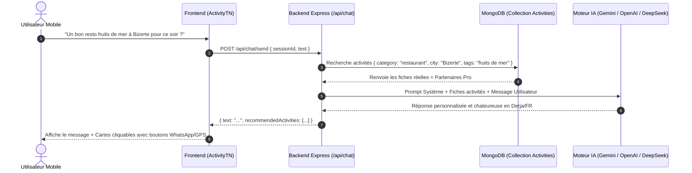

# Guide d'Intégration & Architecture du Chatbot IA (ActivityTN)

> **Document de référence pour le déploiement futur**  
> Ce document détaille où et comment implémenter le Chatbot IA (« Kharja Assistant ») à travers l'application mobile Frontend et le Backend Node.js / MongoDB.

---

## 1. Vision & Rôle du Chatbot dans ActivityTN

Le Chatbot d'ActivityTN n'est pas un bot de support classique. C'est un **Concierge Virtuel de Sorties et de Loisirs en Tunisie**.

### Objectifs Clés :
1. **Recommandation conversationnelle :** Répondre à des besoins naturels (*« On est 4 étudiants à Sousse, budget 25 DT chacun, on veut une terrasse sympa ce soir »*).
2. **Support trilingue & Derja (Tunisien / Arabizi) :** Comprendre les requêtes en Arabe tunisien (*« Win nemchi el lila fi Tunis ? »*), Français et Anglais.
3. **Zéro hallucination (RAG MongoDB) :** L'IA ne cite QUE des activités, cafés et restaurants réels existant dans la base MongoDB d'ActivityTN.
4. **Booster de conversion Partenaire :** Recommander en priorité les partenaires **Pro & Premium** ayant des promotions actives.

---

## 2. Où intégrer le Chatbot dans le Frontend Mobile ?

### A. Les 3 Points d'Entrée Utilisateur (UI)

```
┌───────────────────────────────────────────────────────────┐
│                    Points d'Entrée UI                     │
├─────────────────────────┬─────────────────────────────────┤
│ 1. Bouton Flottant (FAB)│ Bulle brillante animée en bas à │
│                         │ droite de l'écran d'accueil     │
├─────────────────────────┼─────────────────────────────────┤
│ 2. Carte Hero Découverte│ Bannière dans HomeScreenTab :   │
│                         │ « Pas d'idée ? Demandez à l'IA »│
├─────────────────────────┼─────────────────────────────────┤
│ 3. Onglet Bottom Bar    │ (Optionnel) Remplacer ou ajouter│
│                         │ un 5ème onglet « Kharja IA »    │
└─────────────────────────┴─────────────────────────────────┘
```

#### Emplacement recommandé dans le code frontend :
1. **Écran de discussion :**  
   Créer `src/screens/ChatScreen.tsx` (ou modal plein écran via `SwipeableModal`).
2. **Bouton d'accès rapide dans l'accueil :**  
   Dans `src/screens/HomeScreenTab.tsx` :
   - Ajouter un bouton flottant avec `AnimatedGlowButton` ou une icône étincelle `sparkles`.
3. **Cartes d'activités dans le chat :**  
   Créer `src/components/chat/ChatActivityCard.tsx` :
   - Quand l'IA recommande un lieu, elle ne renvoie pas juste du texte mais une **carte cliquable** avec la photo, le prix, la ville, et deux boutons directs :
     - 📞 **Appeler**
     - 💬 **WhatsApp**
     - 📍 **Itinéraire GPS**

---

## 3. Architecture Technique Backend

Le backend possède **déjà les fondations prêtes** :
- Routes existantes : `backend/routes/chat.routes.js`
- Contrôleur : `backend/controllers/chat.controller.js`
- Sessions sécurisées : `backend/services/chatSession.service.js`
- Sécurité & Limiteur de requêtes : `backend/middlewares/rateLimit.middleware.js` (20 msgs/min)

### Schéma du flux IA (RAG - Retrieval Augmented Generation) :



---

## 4. Prompt Système Recommandé pour l'IA

À injecter dans le contrôleur backend lors de l'appel au modèle d'IA :

```text
Tu es "Kharja Assistant", le guide officiel et concierge des sorties en Tunisie sur l'application ActivityTN.
Ton ton est jeune, chaleureux, accueillant et dynamique.

Règles fondamentales :
1. Tu parles et comprends couramment le Français, l'Anglais et l'Arabe tunisien (Derja en caractères arabes et en Arabizi).
2. Réponds toujours dans la même langue que l'utilisateur.
3. Ne recommande JAMAIS d'endroits inventés. Utilise UNIQUEMENT la liste d'activités fournies dans le contexte JSON.
4. Pour chaque recommandation, précise : le nom, la ville, l'ambiance et pourquoi c'est un bon choix.
5. Si un établissement possède un badge "PRO" ou "PREMIUM" ou une promotion, mets-le en valeur en priorité.
6. Termine toujours par une invitation à réserver ou à voir l'itinéraire GPS.
```

---

## 5. Fournisseurs d'IA Recommandés (Coûts & Performance)

| Fournisseur | Modèle | Avantage principal | Coût estimé |
| :--- | :--- | :--- | :--- |
| **Google Gemini** *(Recommandé)* | `gemini-1.5-flash` | Ultra-rapide, quota gratuit généreux, excellente gestion du multilingue et Derja. | **Gratuit au démarrage** puis ~0.075 $ / 1M tokens |
| **DeepSeek** | `deepseek-chat` | Prix imbattable, très performant pour le filtrage structuré JSON. | ~0.14 $ / 1M tokens |
| **OpenAI** | `gpt-4o-mini` | Excellente compréhension contextuelle et formatage. | ~0.15 $ / 1M tokens |

---

## 6. Feuille de Route d'Implémentation (Roadmap Futur)

```
Étape 1 : Branchement LLM Backend
├── Installer le SDK officiel (ex: @google/genai ou openai)
├── Remplacer createBotReply() dans backend/controllers/chat.controller.js
└── Tester les réponses dans Postman

Étape 2 : Connecter la base MongoDB (RAG)
├── Extraire les mots-clés du message utilisateur (ville, budget, ambiance)
├── Requêter MongoDB : Activity.find({ city, category, isAvailable: true })
└── Transmettre les résultats au modèle d'IA

Étape 3 : Interface Utilisateur Mobile
├── Créer src/screens/ChatScreen.tsx avec FlatList de bulles de messages
├── Créer src/components/chat/ChatBubble.tsx
├── Intégrer les cartes d'activités interactives (Bouton d'appel & GPS direct)
└── Ajouter le bouton d'ouverture dans HomeScreenTab.tsx
```

---

## 7. Fichiers Concernés dans le Projet

* **Backend :**
  - [backend/controllers/chat.controller.js](file:///c:/AT/backend/controllers/chat.controller.js) : Remplacement de la réponse mock par l'appel LLM.
  - [backend/services/chatSession.service.js](file:///c:/AT/backend/services/chatSession.service.js) : Historique des conversations par utilisateur.
  - [backend/routes/chat.routes.js](file:///c:/AT/backend/routes/chat.routes.js) : Routes protégées par `chatLimiter`.
* **Frontend Mobile :**
  - `src/screens/ChatScreen.tsx` *(à créer lors du déploiement)*
  - `src/services/chatService.ts` *(à créer pour appeler `/api/chat/send`)*
  - [src/screens/HomeScreenTab.tsx](file:///c:/AT/activitytn/src/screens/HomeScreenTab.tsx) : Point d'accès visible du chatbot.
