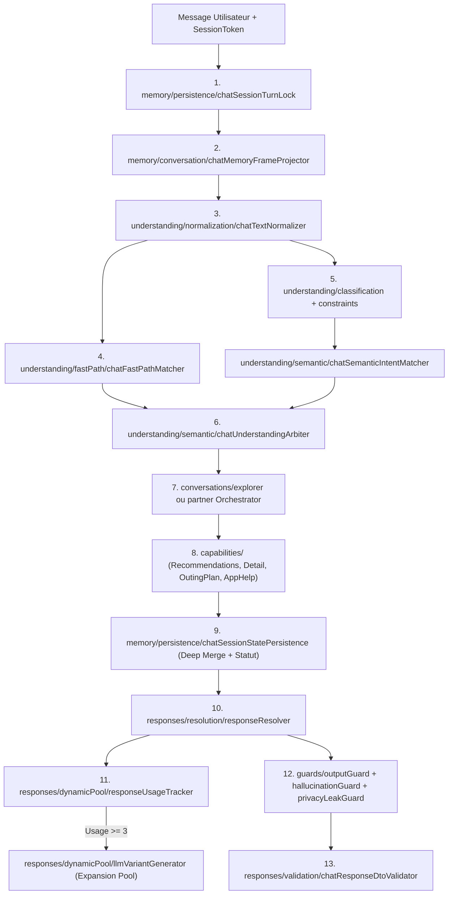

# Architecture Technique & Plan d'Action du Chatbot (KharjaBot / Tfarhida AI)

Ce document décrit l'architecture industrielle, modulaire et déterministe-hybride du système conversationnel **KharjaBot** pour la plateforme **Tfarhida (ActivityTN)**. L'architecture sépare strictement la **Compréhension (`understanding/`)**, la **Mémoire (`memory/`)**, les **Capacités Métier (`capabilities/`)**, la **Génération et Expansion Dynamique des Réponses (`responses/`)**, les **Garde-fous (`guards/`)**, l'Orchestration (`conversations/`) et l'Évaluation continue (`benchmarks/`).

---

## 1. Principes Directeurs de l'Architecture

1. **Zéro Poids sur le Bundle Mobile (+0 Mo)** : Toute l'intelligence conversationnelle réside côté serveur (`backend/services/chatbot/`). L'application mobile et le site web n'échangent que des payloads JSON légers (`< 2 Ko`).
2. **Séparation Stricte des Responsabilités (Single Responsibility par Couche)** :
   - Aucune expression régulière ou règle de compréhension dans les exécuteurs métier ou les constructeurs de réponses.
   - Aucune requête base de données directe dans la couche de compréhension.
   - Tout passage d'une couche à l'autre repose sur un contrat de données explicite et validé (`turnUnderstanding`, `memoryFrame`, `capabilityResult`, `responseDto`).
3. **Pipeline de Compréhension Multi-Étapes (`understanding/`) — Le LLM ne répond jamais directement au client** :
   - **Étape 0 (`normalization/`)** : Nettoyage Unicode, réduction des répétitions (`"caaaafé"` -> `"café"`), translittération Derja/Arabizi (`3`, `7`, `9`, `5`), correction de fautes de frappe (distance Damerau-Levenshtein) et alias géographiques tunisiens (`"marsa"`, `"lac 2"`).
   - **Étape 1 (`fastPath/`)** : Rapprochement ultra-rapide (`< 0.5 ms`) en 2 passes :
     - *Passe 1A (Exact Lookup `O(1)`)* : Table de hachage sur catalogues JSON symétriques (`fr`, `ar`, `en`, `derja`).
     - *Passe 1B (Pattern Rules `schemaVersion: "1.0.0"`)* : Expressions régulières multilingues pré-compilées au démarrage (`fastPath/catalogs/rules/intentRules.v1.json`), triées par `priority DESC` puis `confidence DESC`, extrayant à la fois l'intention (`domain`, `intent`, `subIntent`) et les facettes de contraintes.
   - **Étape 2 (`classification/` & `constraints/`)** : Classification déterministe des actes de dialogue (`dialogueAct`), de la catégorie, de l'ambiance (`vibe`), de l'urgence et extraction structurée des contraintes (`city`, `category`, `budgetLevel`, `maxBudget`, `nearMe`, `amenities`, `excluded`).
   - **Étape 3 (`semantic/`)** : Découpage en clauses (`chatClauseSegmenter`), rapprochement sémantique vectoriel 100% local (`chatMiniLmEmbedder` & `chatSemanticIntentMatcher` + TF-IDF cosinus) sur corpus d'ancres multilingue (FR/EN/AR/Derja), sans aucun appel réseau.
   - **Étape 4 (`llm/chatLlmIntentClassifier` — Gemini 2.5 Flash / Groq)** : Appelé **uniquement en dernier recours si les étapes 1 à 3 sont incertaines** (`confidence < 0.58`). Le LLM (`gemini-2.5-flash` avec `thinkingBudget: 0` en n°1 pour la Derja Tounsia, `Groq llama-3.3-70b-versatile` en secours) **ne rédige jamais la réponse** : il renvoie exclusivement un JSON strict `{ intent, city, category, budgetLevel, amenities }` validé contre `supportedIntentContract.json`.
   - **Étape 5 (`arbiter/chatUnderstandingArbiter`)** : Arbitre souverain multi-couches produisant le contrat immuable `turnUnderstanding`.
4. **Mémoire Conversationnelle, Historique & Statut (`memory/`)** :
   - **Verrouillage de Tour (`chatSessionTurnLock`)** : Empêche les conditions de course (*race conditions*) lorsqu'un utilisateur envoie plusieurs messages simultanément.
   - **Machine à États & Statut (`chatWorkflowStateSchema`)** : Suit le statut exact de la session (`IDLE`, `COLLECTING_CRITERIA`, `RECOMMENDING`, `REFINING`, `INSPECTING_ITEM`, `PLANNING_OUTING`, `PARTNER_ASSIST`).
   - **Deep Merge Additif (`chatSessionStatePersistence`)** : Fusionne récursivement les critères au fil des tours (ex. Tour 1 : *"Un café à La Marsa"* -> Tour 2 : *"Avec Wi-Fi et terrasse"*) sans perdre le contexte initial, tout en gérant les contraintes négatives (`"pas trop cher"`, `"sans chicha"`).
   - **Historique Structuré (`chatConversationHistory`)** : Conserve l'historique des tours (`user` / `bot`), les intentions résolues, les entités extraites et l'identifiant du dernier établissement inspecté (`lastInspectedActivityId`) pour résoudre les pronoms (*"C'est quoi leur numéro ?"*, *"Et le menu ?"*).
   - **Mémoire Anti-Répétition (`recommendations/`)** : Mémorise les établissements déjà présentés (`shownActivityIds`) et l'historique des variantes de réponses utilisées.
5. **Système de Réponses Multi-Variantes & Expansion Dynamique par LLM après 3 Utilisations (`responses/`)** :
   - Chaque intention dispose d'un **pool initial d'au moins 3 variantes de réponses** par langue (`fr`, `ar`, `en`, `derja`).
   - Un sélecteur anti-répétition (`antiRepetitionVariantSelector`) alterne les formulations pour éviter un ton robotique.
   - **Règle des 3 utilisations (`responseUsageTracker` + `llmVariantGenerator`)** : Dès qu'un pool de réponses pour un couple `(intent, language)` atteint **3 utilisations**, le système déclenche automatiquement en arrière-plan (ou à la volée) le générateur de variantes (`llmVariantGenerator.service.js`). Celui-ci crée de nouvelles formulations naturelles qui respectent strictement les placeholders ICU (`{count}`, `{city}`, `{category}`, `{activityName}`), les valide via `outputGuard`, et les injecte dans `dynamicResponseStore.service.js`.

---

## 2. Arborescence Complète (`backend/services/chatbot/`)

```text
backend/services/chatbot/
│
├── benchmarks/                                            <-- ÉVALUATION CONTINUE & QUALIFICATION PAR COUCHE
│   ├── couche0-normalization/
│   │   ├── datasets/
│   │   │   ├── noisyInputs.dataset.json
│   │   │   └── arabiziTunisian.dataset.json
│   │   └── normalization.benchmark.js
│   ├── couche1-fastpath/
│   │   ├── datasets/
│   │   │   └── fastPathExactHits.dataset.json
│   │   └── fastPath.benchmark.js
│   ├── couche2-classification/
│   │   ├── datasets/
│   │   │   └── intentAndConstraints.dataset.json
│   │   └── classification.benchmark.js
│   ├── couche3-semantic/
│   │   ├── datasets/
│   │   │   └── semanticCorpusHoldout.dataset.json
│   │   └── semanticMatcher.benchmark.js
│   ├── couche4-memory/
│   │   ├── datasets/
│   │   │   └── multiTurnDeepMerge.dataset.json
│   │   └── memoryIntegrity.benchmark.js
│   ├── couche5-responses/
│   │   ├── datasets/
│   │   │   └── variantRotationAndExpansion.dataset.json
│   │   └── responses.benchmark.js
│   └── runAllBenchmarks.js                                <-- Orchestrateur global de benchmarks
│
├── understanding/                                         <-- COMPRÉHENSION DU SENS (PIPELINE DÉTERMINISTE & SÉMANTIQUE)
│   ├── normalization/                                     (Étape 0 : Nettoyage, Typo, Arabizi, Villes TN)
│   │   ├── catalogs/
│   │   │   ├── fr/
│   │   │   │   ├── typoDictionary.json
│   │   │   │   ├── phraseAliases.json
│   │   │   │   └── domainKeywordsWhitelist.json
│   │   │   ├── en/
│   │   │   │   └── typoDictionary.json
│   │   │   ├── arabizi/
│   │   │   │   └── tunisianDerjaDictionary.json
│   │   │   ├── geo/
│   │   │   │   └── tunisiaCitiesAliases.json
│   │   │   └── shared/
│   │   │       └── immutableTokens.json
│   │   ├── loaders/
│   │   │   └── normalizationCatalog.loader.js
│   │   └── chatTextNormalizer.service.js
│   │
│   ├── fastPath/                                          (Étape 1 : Rapprochement rapide < 0.5 ms — Exact O(1) + Rules Schema 1.0.0)
│   │   ├── catalogs/
│   │   │   ├── fr/
│   │   │   │   ├── common.json
│   │   │   │   ├── discovery.json
│   │   │   │   └── partner.json
│   │   │   ├── ar/
│   │   │   │   └── common.json
│   │   │   ├── en/
│   │   │   │   └── common.json
│   │   │   ├── derja/
│   │   │   │   └── common.json
│   │   │   ├── rules/
│   │   │   │   └── intentRules.v1.json                    (Règles déclaratives Schema 1.0.0 : priority, confidence, patterns)
│   │   │   └── supportedIntentContract.json
│   │   ├── loaders/
│   │   │   └── fastPathCatalog.loader.js
│   │   └── chatFastPathMatcher.service.js
│   │
│   ├── classification/                                    (Étape 2A : Classifieurs métier & Actes de dialogue)
│   │   ├── chatDialogueActClassifier.service.js
│   │   ├── chatActivityCategoryClassifier.service.js
│   │   ├── chatVibeAndAudienceClassifier.service.js
│   │   ├── chatTimeUrgencyClassifier.service.js
│   │   └── chatClassification.facade.js
│   │
│   ├── constraints/                                       (Étape 2B : Extraction d'entités & filtres cumulables)
│   │   └── chatOutingConstraints.service.js
│   │
│   ├── semantic/                                          (Étape 3 : Recherche Sémantique Locale MiniLM — 0 Appel Externe)
│   │   ├── config/
│   │   │   └── semanticThresholds.config.js
│   │   ├── corpus/
│   │   │   └── semanticIntentCorpus.json
│   │   ├── chatClauseSegmenter.service.js
│   │   ├── chatMiniLmEmbedder.service.js
│   │   └── chatSemanticIntentMatcher.service.js
│   │
│   ├── llm/                                               (Étape 4 : Classifieur d'Intention LLM Isolé — Dernier Recours)
│   │   └── chatLlmIntentClassifier.service.js
│   │
│   └── arbiter/                                           (Étape 5 : Arbitre Souverain Multi-Couches & Contrat Canonique)
│       ├── contracts/
│       │   └── turnUnderstanding.contract.js
│       └── chatUnderstandingArbiter.service.js
│
├── memory/                                                <-- GESTION CENTRALISÉE DE LA MÉMOIRE, HISTORIQUE & STATUT
│   ├── persistence/
│   │   ├── chatSessionTurnLock.service.js
│   │   └── chatSessionStatePersistence.service.js
│   ├── conversation/
│   │   ├── chatWorkflowStateSchema.service.js
│   │   ├── chatConversationHistory.service.js
│   │   ├── chatSessionContextMemory.service.js
│   │   └── chatMemoryFrameProjector.service.js
│   └── recommendations/
│       ├── chatShownActivitiesMemory.service.js
│       └── chatResponseUsageMemory.service.js
│
├── capabilities/                                          <-- EXÉCUTION MÉTIER, RECOMMANDATIONS & PLANS DE SORTIE
│   ├── recommendations/
│   │   ├── activityQueryBuilder.service.js
│   │   ├── activityRanker.service.js
│   │   └── fallbackRelaxation.service.js
│   ├── actionPlanning/
│   │   ├── chatOutingPlanGraph.service.js
│   │   ├── chatOutingPlanExecutor.service.js
│   │   └── chatOutingPlanMemory.service.js
│   ├── establishmentInfo/
│   │   └── activityDetailResponder.service.js
│   └── appHelp/
│       └── appNavigationGuide.service.js
│
├── responses/                                             <-- MULTI-RÉPONSES, ANTI-RÉPÉTITION & EXPANSION LLM (> 3 USAGES)
│   ├── catalog/
│   │   ├── fr/
│   │   │   ├── greetingsAndCommon.Pool.json
│   │   │   ├── recommendations.Pool.json
│   │   │   ├── establishmentDetails.Pool.json
│   │   │   └── partnerHelp.Pool.json
│   │   ├── ar/
│   │   │   └── responses.Pool.json
│   │   ├── en/
│   │   │   └── responses.Pool.json
│   │   └── derja/
│   │       └── responses.Pool.json
│   ├── dynamicPool/
│   │   ├── responseUsageTracker.service.js
│   │   ├── llmVariantGenerator.service.js
│   │   └── dynamicResponseStore.service.js
│   ├── resolution/
│   │   ├── responseResolver.service.js
│   │   ├── antiRepetitionVariantSelector.service.js
│   │   └── variableInterpolator.service.js
│   ├── composition/
│   │   ├── responseComposer.service.js
│   │   └── quickRepliesBuilder.service.js
│   └── validation/
│       └── chatResponseDtoValidator.service.js
│
├── guards/                                                <-- PARE-FEUX DE SÉCURITÉ & VÉRACITÉ DES DONNÉES
│   ├── hallucinationGuard.service.js
│   ├── privacyLeakGuard.service.js
│   └── outputGuard.service.js
│
└── conversations/                                         <-- ORCHESTRATEURS PAR RÔLE & GATEWAY CENTRALE
    ├── explorer/
    │   ├── chatExplorerOrchestrator.service.js
    │   └── chatExplorerIntentRouter.service.js
    ├── partner/
    │   └── chatPartnerOrchestrator.service.js
    └── chatMainGateway.service.js
```

---

## 3. Flux d'Exécution d'un Tour de Conversation (Dataflow)



---

## 4. Machine à États de la Mémoire Conversationnelle (`memory/`)

Chaque session maintient un objet `workflowState` canonique validé par `chatWorkflowStateSchema.service.js` :

| Statut (`status`) | Description | Transitions possibles |
| :--- | :--- | :--- |
| `IDLE` | Début de session ou conversation générale | `COLLECTING_CRITERIA`, `RECOMMENDING`, `INSPECTING_ITEM`, `PLANNING_OUTING`, `PARTNER_ASSIST` |
| `COLLECTING_CRITERIA` | L'utilisateur cherche une sortie mais il manque un critère clé | `RECOMMENDING`, `PLANNING_OUTING` |
| `RECOMMENDING` | Le bot a présenté une sélection d'établissements | `REFINING`, `INSPECTING_ITEM`, `PLANNING_OUTING` |
| `REFINING` | L'utilisateur affine les filtres (*"Moins cher"*, *"Avec terrasse"*, *"Plutôt à Sousse"*) | `RECOMMENDING`, `INSPECTING_ITEM` |
| `INSPECTING_ITEM` | L'utilisateur pose une question sur un lieu précis (*"Horaires ?"*, *"Menu ?"*, *"Instagram ?"*) | `INSPECTING_ITEM`, `REFINING`, `RECOMMENDING` |
| `PLANNING_OUTING` | Planification multi-étapes (ex. Café + Restaurant + Activité) | `RECOMMENDING`, `INSPECTING_ITEM` |
| `PARTNER_ASSIST` | Mode dédié aux partenaires (gestion d'établissement, horaires, promotions) | `PARTNER_ASSIST`, `IDLE` |

### Règle de Fusion Cumulative (*Deep Merge*)
Lorsqu'un utilisateur enchaîne :
1. *"Je cherche un café à La Marsa"* -> `activeFilters = { category: "cafe", city: "La Marsa", amenities: [] }`
2. *"Avec Wi-Fi et climatisation"* -> `Deep Merge` conserve `category: "cafe"` et `city: "La Marsa"` tout en ajoutant `amenities: ["wifi", "climatisation"]`.
3. *"Non plutôt à Sidi Bou Said"* -> `city` est remplacé par `"Sidi Bou Said"`, mais `category: "cafe"` et `amenities` sont préservés.

---

## 5. Système de Réponses Multi-Variantes & Génération Dynamique après 3 Utilisations

### 5.1 Pool Initial (Catalogue Statique)
Pour chaque intention (ex. `RECOMMEND_SUCCESS`, `RECOMMEND_RELAXED`, `ESTABLISHMENT_HOURS`, `GREETING`, `PARTNER_HELP`), le catalogue contient au minimum **3 variantes distinctes** par langue (`fr`, `ar`, `en`, `derja`).

### 5.2 Rotation Anti-Répétition
Le service `antiRepetitionVariantSelector.service.js` inspecte `memory.responseUsage.recentVariantIds` pour la session en cours et sélectionne en priorité une variante qui n'a pas encore été servie à l'utilisateur.

### 5.3 Expansion Automatique au bout de 3 Utilisations (`threshold = 3`)
1. À chaque fois qu'une intention `(intentKey, lang)` est résolue, `responseUsageTracker.service.js` incrémente son compteur d'utilisation.
2. Dès que `usageCount >= 3` (et à chaque multiple de 3 ou lorsque toutes les variantes existantes ont été vues), `llmVariantGenerator.service.js` est invoqué :
   - Si une clé API LLM (`GEMINI_API_KEY` ou `OPENAI_API_KEY`) est configurée, il appelle le modèle léger avec les 3 variantes existantes comme exemples (*few-shot*) et génère 2 nouvelles variantes respectant exactement les mêmes variables `{city}`, `{category}`, `{count}`, `{name}`.
   - Si aucune clé LLM externe n'est configurée (ou hors-ligne), un moteur de synthèse combinatoire déterministe (*Template Morphing Engine*) assemble de nouvelles variantes grammaticalement naturelles et variées sans jamais bloquer le tour.
3. Toutes les nouvelles variantes passent par `outputGuard.service.js` (vérification de l'intégrité des variables `{...}`, absence d'emojis interdits ou de données privées) avant d'être enregistrées dans `dynamicResponseStore.service.js`.

---

## 6. Plan d'Action d'Implémentation & Déploiement

### Phase 1 : Fondations & Compréhension (`understanding/`)
- [x] Créer les catalogues de normalisation (`fr`, `en`, `arabizi`, `geo`, `shared`) et le chargeur mémoire.
- [x] Implémenter `chatTextNormalizer.service.js` (nettoyage, translittération Derja/Arabizi, correction Damerau-Levenshtein, résolution des villes tunisiennes).
- [x] Implémenter `chatFastPathMatcher.service.js` et ses catalogues `0 ms` (`fr`, `ar`, `en`, `derja`).
- [x] Implémenter les classifieurs (`dialogueAct`, `category`, `vibe`, `urgency`) et l'extracteur de contraintes (`chatOutingConstraints.service.js`).
- [x] Implémenter la couche sémantique (`chatClauseSegmenter`, `chatSemanticIntentMatcher`, `chatUnderstandingArbiter`).

### Phase 2 : Mémoire, Statut & Historique (`memory/`)
- [x] Implémenter le verrou atomique de tour (`chatSessionTurnLock.service.js`).
- [x] Définir le contrat d'état canonique (`chatWorkflowStateSchema.service.js`) et le moteur de *Deep Merge* (`chatSessionStatePersistence.service.js`).
- [x] Implémenter la gestion de l'historique multi-tours (`chatConversationHistory.service.js`), du contexte de session (`chatSessionContextMemory.service.js`) et de la mémoire anti-répétition (`chatShownActivitiesMemory.service.js`, `chatResponseUsageMemory.service.js`).

### Phase 3 : Capacités Métier (`capabilities/`)
- [x] Implémenter `activityQueryBuilder.service.js`, `activityRanker.service.js` et `fallbackRelaxation.service.js` (relâchement gracieux si 0 résultat strict).
- [x] Implémenter le planificateur de sortie multi-étapes (`chatOutingPlanGraph.service.js`, `chatOutingPlanExecutor.service.js`, `chatOutingPlanMemory.service.js`).
- [x] Implémenter l'inspecteur de détails d'établissement (`activityDetailResponder.service.js` : horaires, adresse, menu, équipements, téléphone/WhatsApp/Instagram) et le guide d'aide (`appNavigationGuide.service.js`).

### Phase 4 : Réponses Multi-Variantes, Expansion LLM (3 Utilisations) & Garde-fous (`responses/` & `guards/`)
- [x] Créer les pools de réponses multilingues (`fr`, `ar`, `en`, `derja`) avec >= 3 variantes par intention.
- [x] Implémenter `responseUsageTracker.service.js`, `llmVariantGenerator.service.js` et `dynamicResponseStore.service.js`.
- [x] Implémenter `antiRepetitionVariantSelector.service.js`, `variableInterpolator.service.js`, `responseResolver.service.js`, `responseComposer.service.js`, `quickRepliesBuilder.service.js` et `chatResponseDtoValidator.service.js`.
- [x] Implémenter les garde-fous (`hallucinationGuard`, `privacyLeakGuard`, `outputGuard`).

### Phase 5 : Orchestration, Intégration Contrôleur & Benchmarks (`conversations/` & `benchmarks/`)
- [x] Implémenter `chatExplorerIntentRouter.service.js`, `chatExplorerOrchestrator.service.js`, `chatPartnerOrchestrator.service.js` et `chatMainGateway.service.js`.
- [x] Intégrer `chatMainGateway.service.js` dans `backend/controllers/chat.controller.js` et étendre `backend/models/ChatSession.js` tout en préservant 100% de rétrocompatibilité avec les tests existants.
- [x] Créer la suite de benchmarks (`benchmarks/couche0` à `couche5` + `runAllBenchmarks.js`) et les tests unitaires/intégration.
