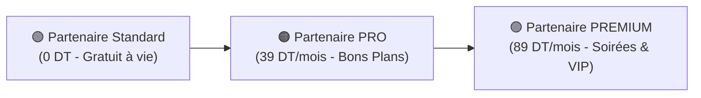
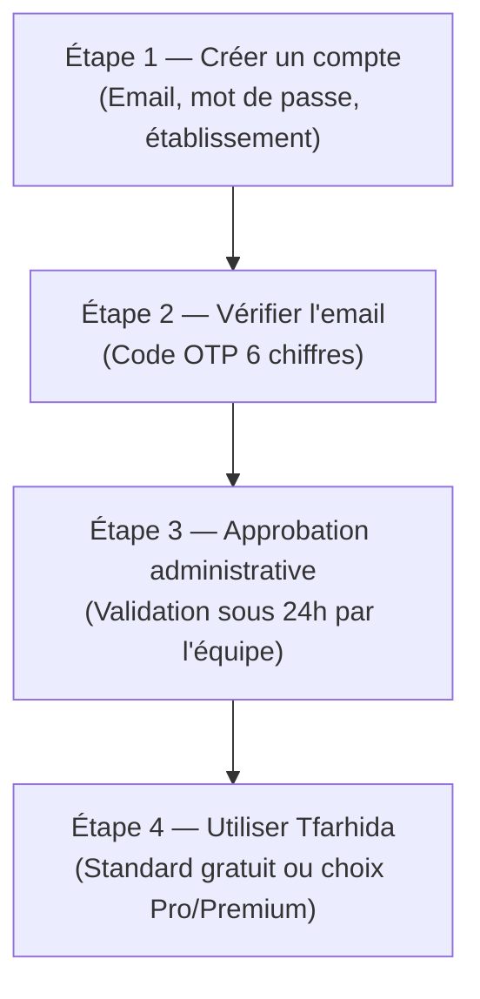

# Architecture Tfarhida (تفرهيدة) : Modèle des Paliers Partenaires, Quotas Notifications & Onboarding

## 1. Vue d'Ensemble & Modèle Économique (3 Niveaux Partenaires)

Pour monétiser la plateforme **Tfarhida** tout en garantissant une expérience utilisateur premium exempte de spam, les comptes partenaires (`role: "partner"`) sont segmentés en **3 paliers hiérarchiques (`partnerTier`)** :

---

## 2. Matrice Comparative Officielle des 3 Niveaux Partenaires

| Fonctionnalité | 🟢 STANDARD *(0 DT - Gratuit)* | 🟠 PRO *(39 DT / mois)* | 🟣 PREMIUM *(89 DT / mois)* |
| :--- | :---: | :---: | :---: |
| **Gestion fiche établissement** (Nom, Photos, Horaires, GPS, Téléphone & WhatsApp) | ✅ Oui | ✅ Oui | ✅ Oui |
| **Mode Électricité / Lumière garantie** (Affiche la lampe 💡 en direct) | ✅ Oui | ✅ Oui | ✅ Oui |
| **Consulter et répondre aux avis clients** | ✅ Oui | ✅ Oui | ✅ Oui |
| **Badge de Confiance sur la fiche** | Badge Standard | ⭐ **Badge Pro Vérifié** | 👑 **Badge Partenaire Or / VIP** |
| **🏷️ Création de PROMOTIONS** *(Réductions globales ou par menu)* | ❌ Non | ✅ **OUI (Illimité\*)** | ✅ **OUI (Illimité\*)** |
| **Mise en avant dans l'application** | Normale | **Bons Plans & Promos** | **Prioritaire (En tête de liste)** |
| **🎤 Création d'ÉVÉNEMENTS & SOIRÉES** *(Concert, DJ, Live acoustic, Bowling...)* | ❌ Non | ❌ Non | 🚀 **OUI** |
| **🔔 Notifications Push ciblées aux utilisateurs** | ❌ 0 / mois | 📱 **2 / mois** | 🚀 **10 / mois** |
| **Statistiques d'engagement (Vues, Clics, Appels WhatsApp)** | Basiques | Complètes | **Avancées en temps réel** |

*\* Avec règles anti-abus pour éviter les publications répétitives ou trompeuses.*

---

## 3. Politique & Philosophie des Notifications Push (Anti-Spam & Valeur)

### 3.1. Pourquoi limiter strictement les notifications push ?
1. **Éviter le spam & préserver la rétention** : Si plusieurs dizaines de cafés envoyaient des alertes chaque jour, les utilisateurs désactiveraient les notifications ou désinstalleraient Tfarhida.
2. **Préserver la valeur perçue des alertes** : Une notification reçue sur le smartphone doit être un événement fort (soirée DJ, concert exceptionnel, réduction exclusive).
3. **Différencier les forfaits avec équilibre** : 
   - **Pro (2/mois)** : Idéal pour 2 temps forts dans le mois (ex: 1er du mois et mi-mois).
   - **Premium (10/mois)** : Permet d'annoncer chaque week-end et temps fort sans saturer les téléphones.

### 3.2. Distinction essentielle : Publication vs Envoi Push
- **Publier un événement ou une promo** : L'événement apparaît en continu dans l'application Tfarhida (catalogue, filtres, fiche).
- **Envoyer une notification push** : Le gérant choisit délibérément de consommer 1 crédit de son quota pour alerter instantanément les utilisateurs ciblés (abonnés et utilisateurs de la ville).

---

## 4. Parcours d'Inscription Partenaire (Onboarding en 4 Étapes)

1. **Étape 1 — Création du compte :**
   - Le gérant renseigne son email professionnel, son mot de passe, son numéro WhatsApp, le nom de son établissement (`establishmentName`), sa ville (ex: Sfax) et sa catégorie.
2. **Étape 2 — Vérification Email (2FA OTP) :**
   - Réception instantanée d'un code numérique sécurisé à 6 chiffres. Confirmation en 1 clic. L'email est certifié (`isEmailVerified = true`).
3. **Étape 3 — Approbation Administrative (Modération) :**
   - L'équipe Tfarhida vérifie l'authenticité de l'établissement avant de rendre sa fiche publique. La vérification email est distincte de cette approbation (`isApproved = true`).
   - Le gérant dispose d'un bouton direct WhatsApp pour contacter l'équipe s'il souhaite accélérer sa mise en ligne.
4. **Étape 4 — Utilisation & Choix du Forfait :**
   - Le gérant accède à son tableau de bord. Il commence gratuitement avec le pack Standard, ou active Pro (39 DT) / Premium (89 DT) pour booster sa visibilité.
