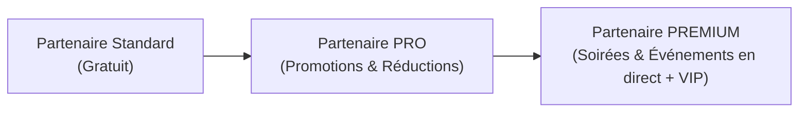
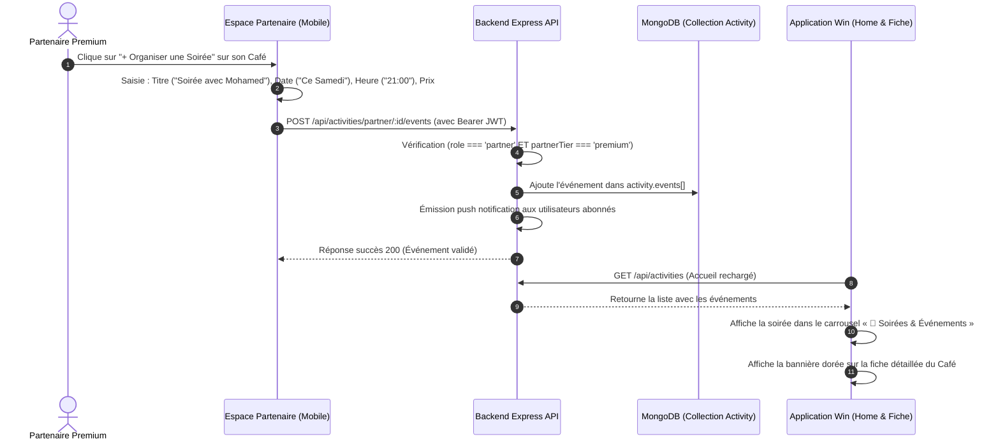
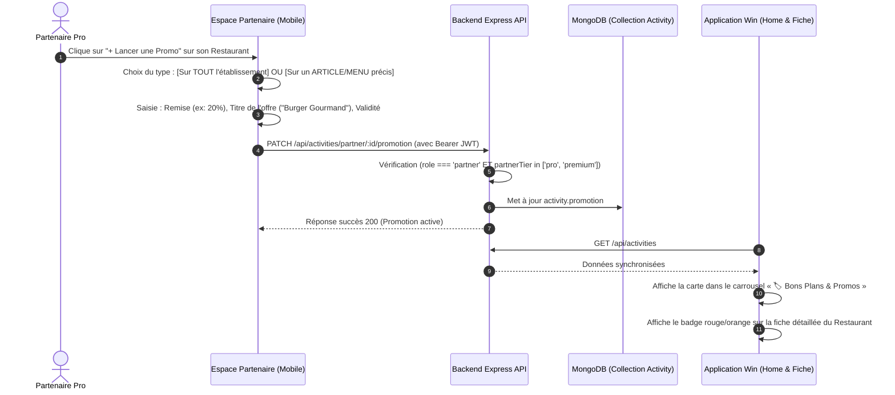

# Architecture Win : Modèle des Paliers Partenaires & Flux Complet Soirées / Promotions

## 1. Vue d'Ensemble & Modèle Économique (3 Niveaux Partenaires)

Pour monétiser l'application **Win** tout en dynamisant les sorties locales (à Sfax et partout en Tunisie), les comptes partenaires (`role: "partner"`) sont segmentés en **3 paliers hiérarchiques (`partnerTier`)** :



---

## 2. Matrice Comparative des 3 Niveaux Partenaires

| Fonctionnalité | 🟢 STANDARD *(Gratuit)* | 🟠 PRO *(Intermédiaire)* | 🟣 PREMIUM *(Haut de Gamme)* |
| :--- | :---: | :---: | :---: |
| **Gestion fiche établissement** (Nom, Photos, Horaires, GPS, Téléphone/WhatsApp) | ✅ Oui | ✅ Oui | ✅ Oui |
| **Mode Électricité / Lumière garantie** (Affiche la lampe 💡 en direct) | ✅ Oui | ✅ Oui | ✅ Oui |
| **Consulter et répondre aux avis clients** | ✅ Oui | ✅ Oui | ✅ Oui |
| **Badge de Confiance sur la fiche** | ❌ Standard | ⭐ **Badge Pro Vérifié** | 👑 **Badge Partenaire Or / VIP** |
| **🏷️ Création de PROMOTIONS** *(Globale ou par Article/Menu)* | ❌ Non | ✅ **OUI (Illimité)** | ✅ **OUI (Illimité)** |
| **Affichage dans la section Home « Bons Plans & Promos »** | ❌ Non | ✅ **OUI** | ✅ **OUI** |
| **🎤 Création d'ÉVÉNEMENTS & SOIRÉES** *(Concert, DJ, Live acoustic, etc.)* | ❌ Non | ❌ Non | 🚀 **OUI (Exclusif)** |
| **Affichage dans la section Home « Soirées & Événements »** | ❌ Non | ❌ Non | 🚀 **OUI (En tête de liste)** |
| **Notifications Push ciblées aux abonnés favoris** | ❌ Non | 1 par mois | 🚀 **Illimitées à chaque soirée** |
| **Statistiques d'engagement (Vues, Clics, Appels)** | Basiques | Complètes | **Avancées en temps réel** |

---

## 3. Flux Complet N°1 : La Soirée Événementielle (Exclusif Partenaire Premium)
*Exemple concret : Un café branché organise une « Soirée Acoustique avec Mohamed » ce samedi à 21h.*



---

## 4. Flux Complet N°2 : La Promotion (Partenaire Pro & Premium)
*Exemple concret : Un restaurant propose une réduction de -20% sur toute l'addition, ou une formule burger à 12 DT au lieu de 16 DT.*



---

## 5. Spécifications Techniques

### 5.1. Backend (`c:\AT\backend`)
* **Modèle `User.js` :**
  ```javascript
  partnerTier: {
    type: String,
    enum: ["standard", "pro", "premium"],
    default: "standard"
  }
  ```
* **Modèle `Activity.js` :**
  ```javascript
  events: [
    {
      title: { type: String, required: true },
      date: { type: String, default: "" },
      time: { type: String, default: "" },
      description: { type: String, default: "" },
      category: { type: String, default: "music" },
      price: { type: Number, default: 0 }
    }
  ],
  promotion: {
    isPromo: { type: Boolean, default: false },
    promoType: { type: String, enum: ["all", "item"], default: "all" },
    discountPercent: { type: Number, default: 0 },
    targetItem: { type: String, default: "" },
    promoLabel: { type: String, default: "" },
    validUntil: { type: String, default: "" }
  }
  ```
* **Contrôles d'accès dans `activity.controller.js` :**
  * `setPromotion` vérifie `['pro', 'premium'].includes(user.partnerTier)`.
  * `createEvent` vérifie `user.partnerTier === 'premium'`.

### 5.2. Frontend Mobile (`c:\AT\activitytn`)
* **`mapActivity()` dans `activityService.ts` :** Mappe systématiquement `events` et `promotion`.
* **Modales de saisie dans `PartnerDashboardScreen.tsx` :**
  * `PartnerProPromoModal` : Sélecteur type promo (Tout vs Article) + pourcentage + label.
  * `PartnerProEventModal` : Titre soirée + date + heure + description.
* **Sections Home (`PartnerEventsSection.tsx` & `PartnerPromosSection.tsx`) :**
  * Affichent dynamiquement les événements et promotions réels sauvegardés.
* **Fiche Établissement (`ActivityDetailsScreen.tsx`) :**
  * Affiche les bannières actives Soirée & Promotion en tête de page.
