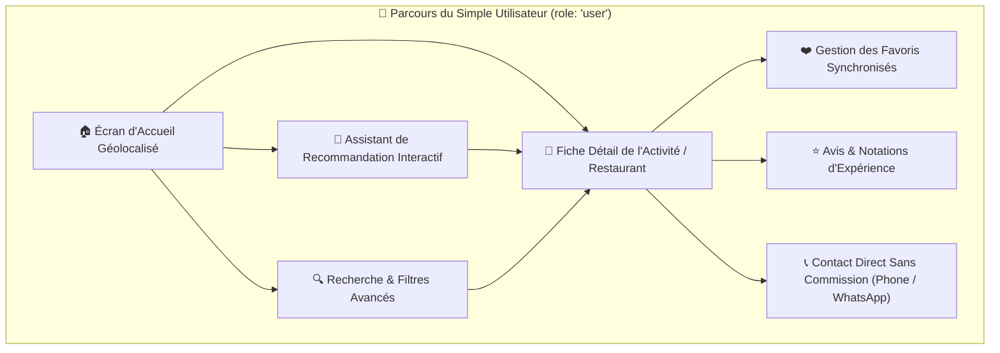

# Architecture Technique du Simple Utilisateur (Explorateur / Client Final)

## 1. Rôle et Vision Métier du Simple Utilisateur

L'utilisateur standard (`role: 'user'`, type virtuel `simple_user`) est le consommateur final de la plateforme **ActivityTN**. Il utilise l'application mobile pour trouver rapidement des activités, des sorties entre amis ou en famille, des restaurants, des cafés de charme ou des loisirs sportifs adaptés à son humeur, son budget et sa localisation en Tunisie.

---

## 2. Matrice des Droits et Permissions du Simple Utilisateur

| Domaine | Action | Statut | Règle Métier |
| :--- | :--- | :--- | :--- |
| **Catalogue** | Consultation | ✅ Autorisé | Lecture de toutes les activités approuvées (`isApproved: true`). |
| **Recherche & Filtres** | Filtrage | ✅ Autorisé | Filtres par catégorie, ville, budget max (DT), distance GPS (km). |
| **Activités** | Création | ❌ Interdit | Réservé aux partenaires (`partner`) et administrateurs (`admin`). |
| **Activités** | Modification/Suppr. | ❌ Interdit | Rejet strict avec code HTTP 403. |
| **Favoris** | Ajout / Retrait | ✅ Autorisé | Persistance bidirectionnelle (état local + collection User MongoDB). |
| **Avis** | Écriture | ✅ Autorisé | 1 avis par utilisateur et par activité avec note de 1 à 5 étoiles. |
| **Avis** | Modification | ✅ Autorisé | Modification restreinte à ses propres avis uniquement. |
| **Avis** | Réactions | ✅ Autorisé | Like, Love, etc. sur les avis des autres membres. |
| **Réservation** | Contact Direct | ✅ Autorisé | Redirection native vers l'application Téléphone ou WhatsApp du partenaire. |

---

## 3. Flux Fonctionnels Clés

### 3.1. Recommandation Intelligente Multicritère
Le composant `RecommendationFlowScreen.tsx` permet à l'utilisateur de répondre à un questionnaire interactif rapide :
1. **Qui vous accompagne ?** (Solo, En couple, Entre amis, En famille avec enfants).
2. **Quelle est l'ambiance recherchée ?** (Calme & Détente, Festif & Énergique, Aventure & Adrénaline, Gourmand).
3. **Budget par personne ?** (Économique < 15 DT, Moyen 15-35 DT, Premium > 35 DT).
4. **Distance & Mobilité ?** (< 5 km, < 15 km, Peu importe).

*Moteur de calcul (`activity.service.js`)* :
Un algorithme de scoring pondéré attribue des points à chaque activité en fonction de la correspondance des tags, de la note moyenne globale et de la proximité géographique.

### 3.2. Synchronisation Optimiste des Favoris
Pour une réactivité immédiate sans latence perçue :
1. L'utilisateur clique sur le cœur d'une activité.
2. L'état React local (`favorites`) est mis à jour instantanément (icône remplie).
3. Une requête asynchrone est émise vers `POST /api/activities/:id/favorite`.
4. Si la requête réseau échoue (ex: perte momentanée de connexion), l'état local est conservé avec avertissement console, et resynchronisé au retour du réseau.

### 3.3. Contact Direct sans Intermédiaire
Contrairement aux plateformes d'intermédiation avec commission, ActivityTN privilégie la mise en relation directe :
- Clic sur "Appeler" : Ouvre `tel:+216XXXXXXXX` via le module React Native `Linking`.
- Clic sur "WhatsApp" : Ouvre `https://wa.me/216XXXXXXXX?text=...` pré-rempli avec le nom de l'activité.

---

## 4. Endpoints Consommés par le Simple Utilisateur

- `GET /api/activities` : Liste paginée des activités publiques.
- `GET /api/activities/:id` : Détails d'une activité avec populate du créateur.
- `POST /api/activities/recommendations` : Calcul des recommandations sur mesure.
- `POST /api/activities/:id/favorite` *(authentifié)* : Ajout/retrait des favoris.
- `GET /api/activities/:id/reviews` : Liste des avis et note moyenne recalculée.
- `POST /api/activities/:id/reviews` *(authentifié)* : Dépôt d'un avis.
- `POST /api/chat/message` *(authentifié ou visiteur avec rate limit)* : Discussion avec l'assistant intelligent.
