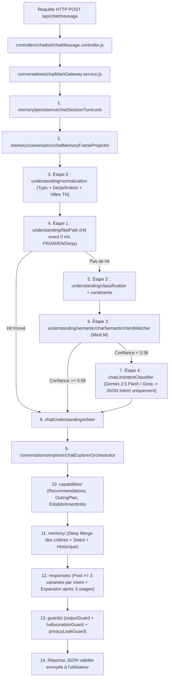

# Plan d'Action & Feuille de Route — Architecture Modulaire Chatbot (KharjaBot Utilisateur)

> **Périmètre** : Chatbot 100% dédié à l'**Utilisateur Simple (Explorateur)** (pas de parcours partenaire).
> **Règle d'Or LLM** : **Gemini 2.5 Flash / Groq ne rédige JAMAIS la réponse directe à l'utilisateur.** Le LLM dans `understanding/` sert **uniquement à comprendre l'intention (`intent`) et extraire les critères (`city`, `category`, `amenities`, `budgetLevel`)** lorsque `FastPath (0 ms)` et `MiniLM` ne sont pas certains. La réponse finale provient **toujours** du dossier contrôlé `responses/`.
> **Documentation d'architecture associée** : [`docs/architecture_chatbot_futur.md`](file:///c:/AT/docs/architecture_chatbot_futur.md)

---

## 1. Vue d'Ensemble du Pipeline d'Exécution

---

## 2. Plan d'Action Détaillé en 7 Phases

### Phase 0 : Contrôleurs Modulaires (`backend/controllers/chatbot/`) — [Terminé]
- [x] [`chatController.shared.js`](file:///c:/AT/backend/controllers/chatbot/chatController.shared.js) : Validation UUID, token SHA-256, constantes.
- [x] [`chatSession.controller.js`](file:///c:/AT/backend/controllers/chatbot/chatSession.controller.js) : Création et récupération sécurisée de session (`getOrCreateSession`).
- [x] [`chatMessage.controller.js`](file:///c:/AT/backend/controllers/chatbot/chatMessage.controller.js) : Réception du message utilisateur et appel à `chatbotReplyProvider` (`sendMessage`).
- [x] [`chatHistory.controller.js`](file:///c:/AT/backend/controllers/chatbot/chatHistory.controller.js) : Lecture de l'historique (`getHistory`).
- [x] [`index.js`](file:///c:/AT/backend/controllers/chatbot/index.js) & façade rétrocompatible [`controllers/chat.controller.js`](file:///c:/AT/backend/controllers/chat.controller.js).

---

### Phase 1 : Couche `understanding/` (FastPath -> MiniLM -> Gemini/Groq Intent Classifier) — [Terminé]
1. **Étape 0 — Normalisation (`understanding/normalization/`)** :
   - [x] Dictionnaires FR (`typoDictionary.json`, `phraseAliases.json`, `domainKeywordsWhitelist.json`), EN (`typoDictionary.json`), Derja/Arabizi (`tunisianDerjaDictionary.json` : `9ahwa`->`café`, `kharja`->`sortie`, `wa9tech`->`horaires`, `mahloul`->`ouvert`, `rkhis`->`petit budget`) et villes tunisiennes (`tunisiaCitiesAliases.json`).
   - [x] Service [`chatTextNormalizer.service.js`](file:///c:/AT/backend/services/chatbot/understanding/normalization/chatTextNormalizer.service.js).
2. **Étape 1 — FastPath 0 ms (`understanding/fastPath/`)** :
   - [x] Catalogues multilingues `fr/`, `ar/`, `en/`, `derja/` et contrat `supportedIntentContract.json`.
   - [x] Matcher [`chatFastPathMatcher.service.js`](file:///c:/AT/backend/services/chatbot/understanding/fastPath/chatFastPathMatcher.service.js).
3. **Étape 2 — Classification Déterministe & Contraintes (`understanding/classification/` & `constraints/`)** :
   - [x] Classifieurs d'actes de dialogue, de catégories, d'ambiance (`famille`, `amis`, `calme`) et d'urgence temporelle (`maintenant`, `ce soir`).
   - [x] Extracteur de contraintes positives et négatives (`"sans wifi"`, `"pas de plage"`) dans [`chatOutingConstraints.service.js`](file:///c:/AT/backend/services/chatbot/understanding/constraints/chatOutingConstraints.service.js).
4. **Étape 3 — Recherche Sémantique MiniLM (`understanding/semantic/`)** :
   - [x] Embedder [`chatMiniLmEmbedder.service.js`](file:///c:/AT/backend/services/chatbot/understanding/semantic/chatMiniLmEmbedder.service.js) (`Xenova/paraphrase-multilingual-MiniLM-L12-v2` + fallback vectoriel subword `< 1 ms`).
   - [x] Matcher cosinus hybride [`chatSemanticIntentMatcher.service.js`](file:///c:/AT/backend/services/chatbot/understanding/semantic/chatSemanticIntentMatcher.service.js) sur corpus FR/EN/AR/Derja.
5. **Étape 4 — Classifieur d'Intention LLM (`understanding/semantic/chatLlmIntentClassifier.service.js`)** :
   - [x] Service [`chatLlmIntentClassifier.service.js`](file:///c:/AT/backend/services/chatbot/understanding/semantic/chatLlmIntentClassifier.service.js) :
     - Utilise **`gemini-2.5-flash` (`thinkingBudget: 0`)** en priorité pour comprendre la Derja Tounsia, et **Groq (`llama-3.3-70b-versatile`)** en secours.
     - **Ne génère jamais de phrase de réponse** : renvoie uniquement `{ intent, city, category, budgetLevel, amenities }` validé contre `supportedIntentContract.json`.
   - [x] Arbitre [`chatUnderstandingArbiter.service.js`](file:///c:/AT/backend/services/chatbot/understanding/semantic/chatUnderstandingArbiter.service.js).

---

### Phase 2 : Couche `memory/` (Verrou, Statut, Historique, Deep Merge) — [Terminé]
- [x] Verrou de tour par session [`chatSessionTurnLock.service.js`](file:///c:/AT/backend/services/chatbot/memory/persistence/chatSessionTurnLock.service.js).
- [x] Machine à états [`chatWorkflowStateSchema.service.js`](file:///c:/AT/backend/services/chatbot/memory/conversation/chatWorkflowStateSchema.service.js) (`IDLE`, `COLLECTING_CRITERIA`, `RECOMMENDING`, `REFINING`, `INSPECTING_ITEM`, `PLANNING_OUTING`).
- [x] Fusion cumulative (*Deep Merge*) des critères entre les tours [`chatSessionStatePersistence.service.js`](file:///c:/AT/backend/services/chatbot/memory/persistence/chatSessionStatePersistence.service.js).
- [x] Historique des tours [`chatConversationHistory.service.js`](file:///c:/AT/backend/services/chatbot/memory/conversation/chatConversationHistory.service.js) et suivi du lieu ciblé (`focusedActivityId`).
- [x] Mémoire anti-répétition des lieux et des réponses (`chatShownActivitiesMemory.service.js`, `chatResponseUsageMemory.service.js`).

---

### Phase 3 : Couche `capabilities/` (Recommandations, Plans de Sortie, Détails) — [Terminé]
- [x] Construction de requêtes MongoDB [`activityQueryBuilder.service.js`](file:///c:/AT/backend/services/chatbot/capabilities/recommendations/activityQueryBuilder.service.js), scoring [`activityRanker.service.js`](file:///c:/AT/backend/services/chatbot/capabilities/recommendations/activityRanker.service.js) et relâchement progressif [`fallbackRelaxation.service.js`](file:///c:/AT/backend/services/chatbot/capabilities/recommendations/fallbackRelaxation.service.js).
- [x] Planificateur de sortie multi-étapes (*"un café puis un restaurant"*) dans `capabilities/actionPlanning/`.
- [x] Extracteur de faits d'établissement (horaires, menu, adresse/Maps, téléphone/WhatsApp/Instagram) dans [`activityDetailResponder.service.js`](file:///c:/AT/backend/services/chatbot/capabilities/establishmentInfo/activityDetailResponder.service.js).

---

### Phase 4 : Couche `responses/` (Pools Multi-Variantes & Expansion après 3 Utilisations) — [Terminé]
- [x] Pools statiques dans `responses/catalog/` (`fr`, `ar`, `en`, `derja`) avec **au moins 3 variantes** par intention.
- [x] Sélecteur anti-répétition [`antiRepetitionVariantSelector.service.js`](file:///c:/AT/backend/services/chatbot/responses/resolution/antiRepetitionVariantSelector.service.js) et interpolateur de variables [`variableInterpolator.service.js`](file:///c:/AT/backend/services/chatbot/responses/resolution/variableInterpolator.service.js).
- [x] Compteur d'utilisation [`responseUsageTracker.service.js`](file:///c:/AT/backend/services/chatbot/responses/dynamicPool/responseUsageTracker.service.js) déclenchant automatiquement [`llmVariantGenerator.service.js`](file:///c:/AT/backend/services/chatbot/responses/dynamicPool/llmVariantGenerator.service.js) dès `usageCount >= 3` pour enrichir [`dynamicResponseStore.service.js`](file:///c:/AT/backend/services/chatbot/responses/dynamicPool/dynamicResponseStore.service.js).

---

### Phase 5 : Couches `guards/` & `conversations/` (Parcours Explorateur Simple) — [Terminé]
- [x] Pare-feux [`hallucinationGuard.service.js`](file:///c:/AT/backend/services/chatbot/guards/hallucinationGuard.service.js), [`privacyLeakGuard.service.js`](file:///c:/AT/backend/services/chatbot/guards/privacyLeakGuard.service.js) et [`outputGuard.service.js`](file:///c:/AT/backend/services/chatbot/guards/outputGuard.service.js).
- [x] Orchestrateur utilisateur simple [`chatExplorerOrchestrator.service.js`](file:///c:/AT/backend/services/chatbot/conversations/explorer/chatExplorerOrchestrator.service.js) et Gateway centrale [`chatMainGateway.service.js`](file:///c:/AT/backend/services/chatbot/conversations/chatMainGateway.service.js).

---

### Phase 6 : Tests & Benchmarks (`tests/` & `benchmarks/`) — [Terminé]
- [x] Tests unitaires et d'intégration complets dans [`backend/tests/chatbot-pipeline.test.js`](file:///c:/AT/backend/tests/chatbot-pipeline.test.js).
- [x] Benchmark de précision et latence dans [`backend/services/chatbot/benchmarks/runAllBenchmarks.js`](file:///c:/AT/backend/services/chatbot/benchmarks/runAllBenchmarks.js).
