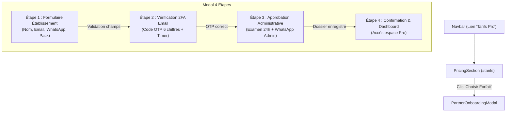

# Spécification de Conception : Grille Tarifaire Partenaires & Onboarding Sécurisé 4 Étapes

- **Date :** 2026-10-25
- **Projet :** Tfarhida.tn (تفرهيدة)
- **Auteurs :** Antigravity & Équipe Produit Tfarhida
- **Statut :** Validé pour Planification

---

## 1. Contexte & Objectifs

L'objectif de cette fonctionnalité est d'offrir une expérience utilisateur irréprochable et transparente aux gérants d'établissements en Tunisie (cafés, restaurants, bowlings, escape games, complexes de loisirs) souhaitant référencer ou promouvoir leurs activités sur **Tfarhida.tn**.

### Objectifs clés :
1. **Clarté Tarifaire :** Présenter les 3 formules (**Standard**, **Pro**, **Premium**) avec toggle Mensuel/Annuel (-25%), les avantages compétitifs et les quotas stricts de notifications push pour lutter contre le spam.
2. **Double Authentification (2FA Email) :** Valider l'adresse email professionnelle via un code OTP numérique à 6 chiffres.
3. **Approbation Administrative :** Séparer la vérification technique de l'email de la modération humaine administrative (sous 24h) pour préserver la qualité de la plateforme.
4. **Cohérence Visuelle :** Support natif et harmonieux des modes **Clair** et **Sombre (Cosmic Midnight)** avec design responsive sur smartphone, tablette et desktop.

---

## 2. Matrice Tarifaire Officielle Tfarhida

| Fonctionnalité | 🟢 STANDARD | 🟠 PRO *(Le Plus Populaire)* | 🟣 PREMIUM *(VIP & Événements)* |
| :--- | :---: | :---: | :---: |
| **Tarif Mensuel** | **0 DT / mois** *(Gratuit)* | **39 DT / mois** | **89 DT / mois** |
| **Tarif Annuel (-25%)** | **0 DT** | **29 DT / mois** *(350 DT/an)* | **69 DT / mois** *(790 DT/an)* |
| **Fiche Complète & GPS** | ✅ Oui | ✅ Oui | ✅ Oui |
| **Contact Direct WhatsApp & Tél** | ✅ Oui | ✅ Oui | ✅ Oui |
| **Veille Lumière / Groupe 💡** | ✅ Oui | ✅ Oui | ✅ Oui |
| **Avis & Réponses Clients** | ✅ Oui | ✅ Oui | ✅ Oui |
| **Badge Officiel** | Standard | ⭐ **Badge Pro Vérifié** | 👑 **Badge Partenaire Or VIP** |
| **Création de Promotions** | ❌ Non | ✅ **Illimitées\*** | ✅ **Illimitées\*** |
| **Mise en Avant Catalogue** | Standard | **Section Bons Plans** | **Prioritaire (En tête)** |
| **Création de Soirées / Événements** | ❌ Non | ❌ Non | 🚀 **Oui (DJ, Live, Concert...)** |
| **Notifications Push Ciblées** | ❌ 0 / mois | 📱 **2 / mois** | 🚀 **10 / mois** |
| **Support Dédié** | Communautaire | Email & FAQ | WhatsApp Direct Prioritaire |

*\* Des règles anti-spam et anti-abus s'appliquent pour garantir des réductions authentiques.*

---

## 3. Architecture des Composants & Flux de Données



### 3.1. Composant `PricingSection.tsx`
- **Emplacement :** `c:\AT\landing\src\components\sections\PricingSection.tsx`.
- **Fonctionnalités :**
  - Toggle Switch : `billingCycle: 'monthly' | 'yearly'` (avec badge visuel `-25% d'économie`).
  - 3 cartes de tarifs avec bordures lumineuses au survol, badge "Recommandé" sur le pack Pro, et badge "VIP" sur Premium.
  - Quotas bien mis en évidence (notamment les 2 et 10 notifications push).
  - Déclencheur du modal `onSelectPlan(plan: 'standard' | 'pro' | 'premium')`.

### 3.2. Composant `PartnerOnboardingModal.tsx`
- **Emplacement :** `c:\AT\landing\src\components\ui\PartnerOnboardingModal.tsx`.
- **Machine à États :**
  ```typescript
  type OnboardingStep = 1 | 2 | 3 | 4;
  interface PartnerFormData {
    managerName: string;
    email: string;
    password?: string;
    establishmentName: string;
    whatsapp: string;
    city: string;
    category: string;
    selectedTier: 'standard' | 'pro' | 'premium';
    otpCode: string[]; // 6 digits
  }
  ```
- **Étape 1 — Formulaire Initial :** Validation des champs requis, masque téléphone tunisien (`+216 XX XXX XXX`).
- **Étape 2 — Saisie du Code 2FA :** 6 inputs numériques avec auto-focus, paste automatique et compte à rebours de 60 secondes pour renvoi de code.
- **Étape 3 — Statut Approbation Administrative :** Message informatif expliquant l'examen humain sous 24h, badge d'attente ambré, et bouton direct WhatsApp vers le support Tfarhida (+216 74 000 000).
- **Étape 4 — Accès Espace Partenaire :** Récapitulatif du statut et bouton pour fermer le modal ou explorer les outils.

---

## 4. Adaptabilité Graphique & Thèmes (Light / Dark Mode)

Les nouveaux composants utiliseront exclusivement les variables CSS globales de Tfarhida :
- Fond de cartes : `var(--bg-card)`
- Fond de section : `var(--bg-main)`
- Textes : `var(--text-primary)`, `var(--text-secondary)`, `var(--color-navy)`
- Bordures : `var(--border-subtle)` et `var(--border-strong)`
- Accents : `var(--color-primary)` (Bleu Tfarhida), `#10B981` (Vert succès), `#F59E0B` (Ambre attente).

---

## 5. Gestion des Erreurs & Cas Limites

1. **Email non valide / Inexistant :** Vérification regex stricte avant passage à l'étape 2.
2. **Code OTP incorrect :** Affichage d'un message d'erreur rouge avec secousse visuelle (*shake animation*) et réinitialisation des cases.
3. **Fermeture intempestive du modal :** Sauvegarde temporaire dans le state parent ou `sessionStorage` pour ne pas forcer le gérant à tout ressaisir.
4. **Accessibilité :** Support de la touche `Escape` pour fermer, touches `ArrowLeft` / `ArrowRight` dans les cases OTP.

---

## 6. Critères d'Acceptation & Vérification

- [ ] La section Tarifs s'affiche correctement sur `http://localhost:5174/` avec le toggle mensuel/annuel calculant les prix sans décalage.
- [ ] La Navbar intègre un lien direct `#tarifs` et le bouton « Espace Pro » ouvre l'onboarding.
- [ ] Le modal d'inscription permet de naviguer de l'étape 1 à 4 avec animation fluide.
- [ ] La saisie du code 2FA à 6 chiffres saute automatiquement d'une case à l'autre.
- [ ] Le bouton WhatsApp Admin à l'étape 3 génère un lien pré-rempli avec le nom de l'établissement.
- [ ] La compilation TypeScript (`npx tsc --noEmit`) et le build Vite (`npx vite build`) réussissent sans aucune erreur.
- [ ] Les modes Clair et Sombre s'appliquent parfaitement à l'ensemble des nouveaux composants.
